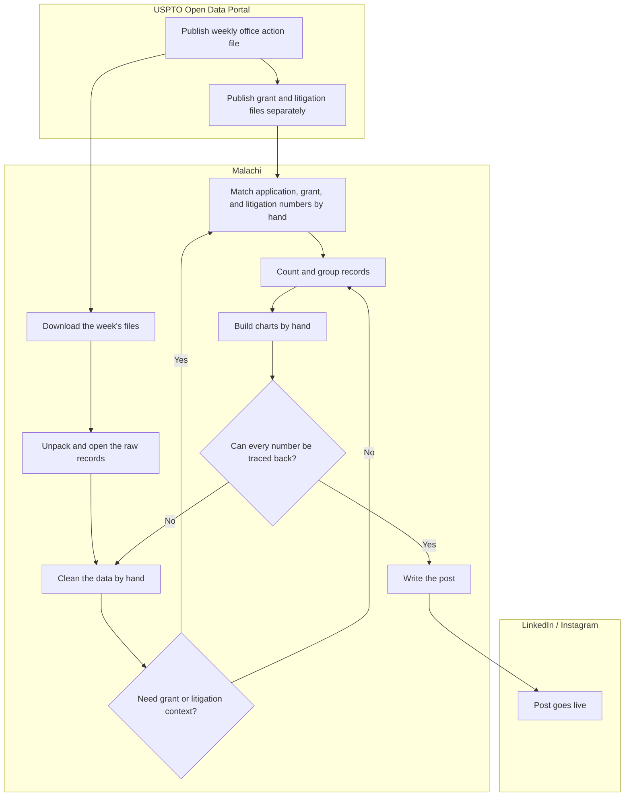
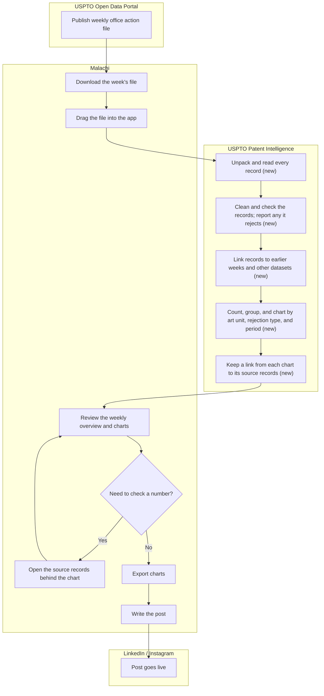
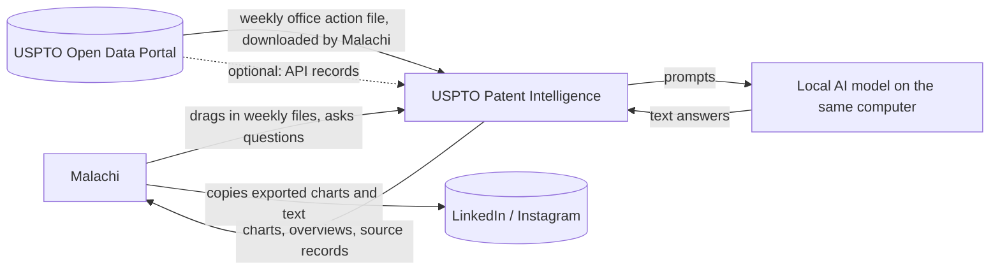

# Vision and Scope

**Project:** USPTO Patent Intelligence
**Team:** 6
**Client:** Malachi Hernandez
**Version:** 1.2

---

_**How to use this template.** Every section below opens with an instruction in italic square brackets: what the section is for, how to produce it, a worked example, and a checklist. Fill in the section underneath the instruction. **Leave the instructions in the file until the document is stable.** They are context for you, for the teammate who writes a later section, and for your AI teammate, which reads this file every time it works on your project._

_**This document has two readers.** Your client has to recognize their own business in it, so avoid jargon they would not use. Your AI teammate has to build from it, so avoid a claim it cannot check. When the two pull against each other, write for the client and put the precision in the use cases._

_**Work it with your agent, not instead of it.** Give the agent this template, your one-page project brief, and your meeting notes, then put it in a role: "You are an experienced business analyst. Using the instructions in this template, draft section X, and list every question you cannot answer from what I gave you." The questions it cannot answer are the point. They go in [OPEN-ISSUES.md](OPEN-ISSUES.md) and they become the agenda for your next client meeting. What the agent cannot do is decide which of its questions deserve your client's limited time, or tell enthusiasm apart from commitment. That judgment is yours._

## Identifiers in this document

_Identifiers here are **name-based slugs**, never numbers._

| Space | Shape | Example |
|---|---|---|
| Business objective | `BO-<slug>` | `BO-grading-time` |
| Success metric | `SM-<slug>` | `SM-submission-rate` |
| Risk | `RI-<slug>` | `RI-cloud-cost` |
| Assumption or dependency | `AS-<slug>` | `AS-client-maintains-stack` |
| Feature | `FEAT-<slug>` | `FEAT-performance-tracking` |

| Space | Example | Example | Example |
|---|---|---| --- |
| Business objective | `BO-Post-Visuals` | `BO-Weekly-Series` | `BO-Zero-Cost` |
| Success metric | `SM-Accuracy` | `SM-Prep-Time` | `SM-Complete-Intake` |
| Risk | `RI-Storage-Cost`| `RI-Unsupported-Claims` | `RI-Format-Drift` |
| Assumption or dependency | `AS-local` | `AS-client-maintains-stack` | `AS-weekly-file-format` |
| Feature | `FEAT-Verify-Source` | `FEAT-Intake-Data` | `FEAT-Generate-Visualization` |

_Coin each slug from the concept itself: short, kebab-case, unique within its space. **Never renumber, rename, or repoint an identifier.** A new item gets a new slug; a retired item keeps its slug and is marked withdrawn. Cite items by identifier, never by position in a list ("the third objective")._

_Why this matters more with an agent than it used to: ask an agent to insert a new objective into a list numbered `BO-1` through `BO-6` and it has two options. Renumber everything, silently breaking every citation in your use cases and your specification, or append out of order. No test you can write detects either one. A slug has neither failure mode, and it tells a reader what the item is at the place it is cited._

## Revision History

| Date | Version | Description | Author |
|---|---|---|---|
| 2026-09-13 | 0.1 | Initial draft from the client brief | Turner DeMott |
| 2026-09-20 | 1.0 | First draft post-meeting with Malachi | Turner DeMott |
| 2026-09-21 | 1.1 | First team draft | Team |
| 2026-10-27 | 1.2 | Filled remaining sections from the gap report; added figures from the 2026-10-18 sample weekly file | Turner DeMott |


---

## 1. Introduction

_[This document defines the goals, purpose, and boundaries of the project. It gives every stakeholder a shared understanding of what the software is for and the context it operates in: the business problem being solved, how the software fits into the client's world, and where the line falls between what is in scope and what is not.]_

This document states why USPTO Patent Intelligence is being built, who it is for, what it must do, and what is expected to actually be shipped when the project is complete. This will allow the team, the client, and any AI agent working from this file to share one understanding of the product before design work starts.

### 1.1 Background

_[Summarize the rationale and context for the new product, or for the changes to an existing one. Describe the situation that led to the decision to build it.]_

Malachi Hernandez is an entrepreneur working in intellectual property (IP) and AI. He co-owns a three-year-old IP/AI company with a friend; its products have matured and the company is currently up for sale. He also helps small businesses adopt AI, travels with the US Department of State as part of a speakers program on 6G and IP, and has sponsored senior projects at TCU and Texas A&M for the past three years. IP is the area he is most passionate about.

This project is personal, separate from Malachi's companies. Regardless of whether his business sells, he wants to stay connected to the patent space by publishing data-driven IP content (primarily LinkedIn, occasionally Instagram) analyzing USPTO examination activity. He is the only intended user of the tool. He will use its output for his posts and reports, which should reach an audience that includes USPTO, Congress, and US Department of State readers.

The subject of those posts is the United States Patent and Trademark Office (USPTO), the federal agency that examines patent applications. Its examiners are grouped into [Technology Centers](project-glossary.md#technology-center) and [Art Units](project-glossary.md#art-unit), and each time an examiner finds a problem with an application they issue an [Office Action](project-glossary.md#office-action). The USPTO publishes these office actions as public [bulk data](project-glossary.md#weekly-release). One week of that data is substantial: the sample file Malachi provided (`bdr_oa_bulkdata_weekly_2026-10-18.json`) holds 8,667 office actions submitted between 13 and 16 October 2026, issued by 4,882 examiners in 524 art units across 10 Technology Centers. Malachi's goal is not to comment on individual patents but to show, week by week, how well the agency is functioning.

_**Step 1: Describe the business.** Introduce the organization. Cover what it does (industry, products, services), its size (employees, locations), and the goals that relate to the problem you are solving._

_Example: "The client, XYZ Logistics, is a mid-sized shipping company that specializes in last-mile delivery services for e-commerce businesses. The company operates in five major cities, employs 200 delivery staff, and handles over 10,000 deliveries per day. The goal is to optimize delivery efficiency and customer satisfaction."_

_**Checklist:** Would a reader who has never heard of this organization understand what it does and why this project exists?]_

### 1.2 Current Process Flows (As-Is Process Flows)

_[Most projects require everyone involved to have a firm grasp of the business process being created, replicated, or improved. Without that understanding there is little chance users adopt the new solution. Process flows are the most effective model for building it.]_

No tool for this exists today, and Malachi does not yet publish these posts regularly. The flow below is the manual process he followed in his dry runs, as described in the first client interview (2026-09-17). It will be checked against the process video he said he would send.



Each week the USPTO releases a new office action file. Malachi downloads it, unpacks it, and has to clean it before it is usable, because the USPTO publishes it as a raw dump. If a post needs more than one week's examination activity, such as what happened to an application after it was granted, he has to find the same invention in the separately published grant and litigation files. Those files use different numbers, so he matches them by hand. He then counts and groups the records, builds the charts, checks that each number can be traced back to the source, and writes the post. Data preparation took him 4 to 6 hours in his dry runs, and writing took another 2 to 4, so one post costs about 8 hours.

**Current tools and their limitations**

| Tool | Used for | Limitation |
|---|---|---|
| USPTO Open Data Portal (bulk files and API) | Getting the data | Publishes raw, uncleaned files; office action, grant, and litigation data are separate silos. The API sometimes drops out for about 2 minutes. |
| Spreadsheets | Counting and charting | One weekly file is 383 MB of text and mostly long office action letters, too much for a spreadsheet to handle comfortably. Malachi does not want to work in Excel. |
| His company's existing tools | Part of the analysis | Narrowly scoped; they do not produce weekly, agency-level analysis. |
| LinkedIn / Instagram | Publishing | No connection to the data; every chart and figure is copied in by hand. |

**Pain points**

- **Time.** About 8 hours per post (4–6 hours of data work, 2–4 hours of writing). At that cost a weekly series cannot be sustained alongside his other work.
- **Messy, inconsistent data.** In the 2026-10-18 sample, every record is tagged with exactly one rejection type, yet 2,087 records contain §102 rejection text without a §102 tag. A chart counted from the tags alone would undercount §102 rejections by more than three times (833 tagged against 2,798 records with §102 text). Fields are also unevenly filled: only 2,701 of the 8,667 records have a national patent class.
- **Siloed datasets.** Office action, grant, and litigation data identify the same invention by different numbers, so following one invention across them is manual work.
- **Credibility.** Readers include USPTO, Congress, and State Department staff. A single figure that cannot be traced back to the data damages trust in the whole series.

_**Step 1: Diagram the current process.** Draw the process people execute **today**, before your software exists, as a mermaid flowchart with **one subgraph per actor** (roles, departments, existing systems). Show the sequence of activities, the decision points, and the handoffs between actors._

_Diagrams in this project are authored as mermaid inside the Markdown file, never exported from a drawing tool as an image. A picture of a diagram is invisible to your AI teammate and unreadable in a diff; a mermaid block is text it can read and revise. A skeleton to start from:_

    ```mermaid
    flowchart TD
      subgraph Student
        A[Open the shared spreadsheet] --> B[Type last week's activities]
      end
      subgraph Instructor
        C[Review the updated sheets] --> D{Complete?}
        D -- No --> E[Email the student]
        D -- Yes --> F[Enter the grade in the LMS]
      end
      B --> C
    ```

_**Step 2: Write the prose.** Not every reader reads diagrams. Explain the flow in a paragraph underneath it._

_**Step 3: List the current tools.** Enumerate what the process runs on today (spreadsheets, paper schedules, email, a legacy system) and give the limitation of each._

_Example: "XYZ Logistics relies heavily on Excel spreadsheets for order management. Printed delivery schedules are distributed to drivers daily. These tools lack automation, making the process prone to human error and delays."_

_**Step 4: Name the pain points.** Highlight the inefficient, slow, or error-prone steps, using one or two specific examples rather than a general complaint._

_Inefficiency example: "Manual entry of order details into Excel causes delays and transcription errors. During peak season, order entries pile up, delaying processing and delivery."_

_Time example: "Printing and distributing delivery schedules to drivers takes 2 hours daily, cutting into time available for deliveries."_

_**Step 5: Write for an outsider.** Assume your reader knows nothing about this domain. Define every domain term on first use and add it to the [project glossary](project-glossary.md)._

_**Checklist:** Is the business context clear to someone unfamiliar with it? Does the flow give step-by-step detail? Are all actors and tools described? Are the inefficiencies illustrated with specific examples? Is there a mermaid diagram with one subgraph per actor?]_

### 1.3 References

_[List every document referenced elsewhere in this one: the client's project brief, existing forms and reports, regulations, standards, competing products. Identify each by title, date, and where it can be obtained. The spreadsheet or screenshot your client showed you belongs here.]_

| Reference | Date | Where to get it |
|---|---|---|
| Client project brief: *Local Patent Intelligence & USPTO Operations Analytics* (pitch slides) | Fall 2026 | TCU Online, course site |
| Client interview notes, meeting #1 | 2026-09-17 | [client-interview-2026-09-13.md](client-interview-2026-09-13.md) |
| Sample weekly office action file `bdr_oa_bulkdata_weekly_2026-10-18.json` (8,667 records, 383 MB) | 2026-10-18 | Provided by the client; kept in the repository's `example data/` folder, which is git-ignored |
| USPTO Open Data Portal | Ongoing | https://data.uspto.gov |
| Project glossary | Current | [project-glossary.md](project-glossary.md) |
| Business rules | Current | [business-rules.md](business-rules.md) |
| Software requirements specification | Current | [software-requirements-specification.md](software-requirements-specification.md) |
| Client process video | Pending | Promised by the client; not yet received |

---

## 2. Business Requirements

_[Projects are launched in the belief that creating or changing a product will provide worthwhile benefits for someone. Business requirements describe the primary benefits the new system will provide to its sponsors, buyers, and users. Input comes from the people who know **why** the project is being undertaken: your client, their management, a subject matter expert, a product visionary. Business requirements determine which user requirements get implemented and in what order, so take this section seriously.]_

### 2.1 Business Opportunity or Problem Statement

_[State the problem being solved or the opportunity being exploited, in the client's own terms. One or two paragraphs. This is the answer to "why is anyone paying for this?"]_

Producing one post today would cost him roughly eight hours, because the underlying USPTO Office Action and litigation data arrives as large, uncleaned, siloed bulk files that he has to reconcile and visualize by hand before he can write anything. He wants a private, low-cost, local tool that turns each week's USPTO release into verifiable, ready-to-publish charts and text, without depending on paid cloud AI services and without ever claiming something the data cannot support.

### 2.2 Business Objectives

_[Summarize the business benefits the product will provide, **quantitatively and measurably**. Platitudes ("become recognized as a world-class provider") and vague improvements ("provide a more rewarding customer experience") are neither helpful nor verifiable.]_

- `BO-Post-Visuals`: Reduce the data-preparation time for one post (from downloading a weekly release to having publish-ready charts) from 4–6 hours to under 1 hour, which cuts a full post from about 8 hours to under 5.
- `BO-Weekly-Series`: Make it possible for Malachi to publish a data-backed post about USPTO examination activity every week. Baseline: no regular series exists today because each post costs about 8 hours.
- `BO-Zero-Cost`: Keep the cost of running the tool at $0 per month: no hosting, subscription, or paid AI API fees. Baseline: $0 (no tool).
- `BO-Credible-Content`: Publish no post that has to be corrected because of a figure the tool produced. Baseline: no posts published yet.

_Examples:_

- _`BO-submission-rate`: Increase the weekly activity report and peer evaluation submission rate by 20%._
- _`BO-student-effort`: Reduce the time a student spends completing a weekly activity report and peer evaluation by 25%._

_**How to elicit these.** Clients rarely volunteer numbers. Ask: What business problem are you trying to solve? What is the motivation for solving it now? What would a highly successful solution do for you? What is a successful solution worth? If the answer contains no number, ask what the number is today._

_**Checklist:** A year from now, could someone tell whether each objective was met? Does each one contain a quantity?]_

### 2.3 Success Metrics

_[Business objectives say what should improve. Success metrics tell you **whether you are on track to get there**, and they can be measured far sooner. That gap is the reason this section exists. A business objective often cannot be measured until well after the project ends, and sometimes depends on projects beyond yours, but you still need to know during the semester whether you are heading the right way.]_

_Specify the indicators stakeholders will use to define and measure success on this project. Identify the factors with the greatest impact on achieving it, including factors outside the organization's control._

_A success metric is sometimes the same statement as a business objective, when the objective happens to be measurable early. "Reduce time spent ordering chemicals to 10 minutes on 80 percent of orders" serves as both, because average order time can be measured during testing or shortly after release. Where an objective is measured a year out, write a metric that tracks the same thing on a shorter timeline: against an adoption objective measured annually, "track 60 percent of commercial chemical containers and 50 percent of proprietary chemicals within 4 weeks"._

_For each metric give the indicator, where the number comes from, what it is today (the baseline), and what counts as success by when. A metric with no baseline is not measurable, and "we do not track that today" is a finding worth recording rather than a gap to paper over._

| Metric | Indicator | Source | Baseline | Target and deadline | Traces to |
|---|---|---|---|---|---|
| `SM-Accuracy` | Share of figures in exported charts that match a manual recount from the source records | Team spot check: 20 figures from one real weekly release, recounted directly from the raw file | No tool exists; not measured | 100% (20 of 20) at the final demo, December 2026 | `BO-Credible-Content` |
| `SM-Prep-Time` | Malachi's hands-on time from a new weekly file to exported charts, not counting unattended processing | Timed session with Malachi using a real weekly release | 4–6 hours (client interview, 2026-09-17) | Under 1 hour at the final demo, December 2026 (`USE-weekly-data-time`) | `BO-Post-Visuals`, `BO-Weekly-Series` |
| `SM-Complete-Intake` | Records imported plus records rejected with a stated reason, as a share of records in the file | Import summary, checked against a line count of the file | Not measured; the 2026-10-18 sample has 8,667 records | 100%: no record is silently dropped, by the final demo, December 2026 | `BO-Credible-Content`, `BO-Post-Visuals` |
| `SM-Traceable-Visuals` | Share of exported charts whose source records can be opened from the chart | Review of every chart exported during testing | No tool exists; not measured | 100% by the final demo, December 2026 (`FEAT-Verify-Source`) | `BO-Credible-Content` |
| `SM-Running-Cost` | Monthly spend needed to run the tool | Malachi's statements for any service the tool uses | $0 | $0 in each of the first 3 months after hand-off | `BO-Zero-Cost` |

`BO-Weekly-Series` can only be judged after hand-off, so `SM-Prep-Time` is its early indicator: if the hands-on time is under 1 hour, a weekly post is realistic. A factor outside the project's control is whether the USPTO keeps publishing the weekly file in its current form (`RI-Format-Drift`).

_Examples:_

- _`SM-cafeteria-adoption`: 75% of employees who used the cafeteria at least 3 times per week during Q3 2013 use the Cafeteria Ordering System at least once a week, within 6 months following initial release._
- _`SM-satisfaction`: The average rating on the quarterly cafeteria satisfaction survey increases by 0.5 on a scale of 1 to 6 from the Q3 2013 rating within 3 months following initial release, and by 1.0 within 12 months._

_**How to elicit these.** Ask "how will you know this worked?", then ask what that number is today. If your client cannot say, ask who would know and whether the number is recorded anywhere. Clients often propose a metric the software cannot influence (revenue, headcount); trace it back to something your system actually changes._

_**Choose your success metrics wisely. Make sure they measure what is important to the business, not just what is easy to measure.** "Reduce product development costs by 20 percent" is easy to measure, and also easy to achieve by laying off employees or investing less in innovation, neither of which is the intended outcome. Prefer a metric that gets worse if you build the wrong thing._

_**Checklist:** Does each metric name its source, its baseline, and its deadline? Can this software actually move it? Can it be measured during testing or shortly after release, rather than a year later? Does every business objective have at least one metric behind it, and does every metric trace back to an objective?]_

### 2.4 Vision Statement

_[One statement summarizing, at the highest level, the position this product intends to fill. Fill in the table.]_

| | |
|---|---|
| **For** | Malachi Hernandez, an entrepreneur who publishes IP content |
| **Who** | needs credible, data-backed visuals and text about USPTO examination activity without spending a full workday producing each post |
| **The** USPTO Patent Intelligence app | is a local desktop application |
| **That** | takes in weekly USPTO office action bulk data (and later grant and litigation data), cleans and links it, and produces publish-ready charts that trace every number back to its source records, entirely on his own computer |
| **Unlike** | the manual process of downloading, cleaning, and charting raw USPTO files by hand, which takes about 8 hours per post |
| **Our product** | cuts the data work to under an hour, makes no claim the data cannot support, and costs nothing to run because it uses no cloud AI |

_**Use this in the meeting.** Read the filled-in table back to your client out loud and watch what they correct. It is the fastest way to discover you misunderstood the project, and it costs ninety seconds. Corrections go straight into [OPEN-ISSUES.md](OPEN-ISSUES.md)._

### 2.5 Proposed Process Flows (To-Be Process Flows)

_[Draw the improved process, with your software in it, as a second mermaid flowchart in the same shape as the as-is flow. Show how the software interacts with each actor, which steps it automates, and which pain point from section 1.2 each change addresses. Label the steps that are new or significantly changed, and say plainly which manual steps **remain** and why. There may be several major flows.]_

Steps marked **(new)** are done by the application instead of by hand. This flow is based on the interview and the 2026-10-18 sample file; it will be revised once the client's process video arrives.



**How each change addresses a pain point from section 1.2**

| Change | Pain point addressed |
|---|---|
| The app unpacks, cleans, and checks each weekly file, and reports any records it could not use | Messy, inconsistent data; time |
| The app counts rejections from both the rejection tags and the rejection text, and says which one each chart uses | Messy, inconsistent data (the §102 undercount) |
| The app links office actions to earlier weeks and, once available, to grant and litigation records | Siloed datasets |
| Every chart keeps a link to the records it was built from | Credibility |
| Processing runs unattended, for example overnight | Time |

**Manual steps that remain, and why**

- **Downloading the file.** The client prefers the bulk files to the API (`CO-bulk-data-first`), and the USPTO's API is unreliable. Automatic download can be added later.
- **Reviewing and checking the charts.** The client wants a verification step before anything is published. The app makes it fast; it does not remove it.
- **Writing the post and publishing it.** The post is in Malachi's voice, and the app has no connection to LinkedIn or Instagram by design (`CI-no-external-messages`).

_The point of drawing both is the comparison. If the two diagrams look alike, either you have not understood the current process or the software is not worth building._

### 2.6 Risks

_[Summarize the major business risks of building this product, and of not building it. Categories include competition, timing, user acceptance, implementation, and negative impact on the business. Business risks are not project risks: "a teammate might drop the course" is a project risk and does not belong here. Give probability and impact for each, and a mitigation where you have one.]_

Probability is from 0 to 1; impact is from 1 (minor) to 9 (severe).

- `RI-Unsupported-Claims`: The local AI model can state a number or trend that is not in the data. If Malachi publishes it to readers at the USPTO, Congress, or the State Department, the error damages the credibility of the whole series. (Probability 0.5, Impact 9.) *Mitigation:* AI output must cite the records it is based on (`FEAT-Verify-Source`), and charts are calculated directly from the data, never by the AI model.
- `RI-Inconsistent-Source-Fields`: The USPTO's own fields disagree with each other. In the 2026-10-18 sample, 2,087 records contain §102 rejection text but are not tagged as §102. A chart built from the tags alone would publish a figure that is wrong by more than three times. (Probability 0.7, Impact 7.) *Mitigation:* Agree with the client which field counts as the source of truth; label every chart with the field it was counted from.
- `RI-Format-Drift`: The USPTO changes the layout or field names of its weekly file without notice, and the import either fails or silently drops values, corrupting every chart built afterward. (Probability 0.4, Impact 7.) *Mitigation:* Check each file against the expected fields and refuse files that do not match, rather than guessing (`ROB-format-change`).
- `RI-Storage-Cost`: Malachi wants years of history kept to support trend charts. One week of office action data is 383 MB, about 20 GB per year before any grant or litigation data, and the client expects some downloads to be far larger (20–50 GB). Several years could fill his 2 TB drive or force a paid storage upgrade, which conflicts with `BO-Zero-Cost`. (Probability 0.3, Impact 5.) *Mitigation:* Store only the fields the charts need and compress the stored data; show how much space the data uses (`DI-storage-visibility`).
- `RI-Local-AI-Too-Slow`: A model small enough to run on a MacBook Air with no separate graphics card may be too slow or too weak to be useful, so the AI features go unused. (Probability 0.4, Impact 4.) *Mitigation:* Make the AI assistant optional and keep the core charts independent of it (section 4.3).
- `RI-Examiner-Identification`: The data identifies each examiner by employee number. Posts that rank or criticize individual examiners could expose real people to public criticism and harm Malachi's standing with USPTO readers. (Probability 0.3, Impact 6.) *Mitigation:* Report at the art unit and Technology Center level by default; ask the client for a rule (`DI-identifiable-people`).
- `RI-No-Tool`: If the tool is not built, each post keeps costing about 8 hours, and Malachi is unlikely to sustain a weekly series alongside his other work. (Probability 0.8, Impact 6.)

_Examples:_

- _`RI-union-contract`: The Cafeteria Employees Union might require its contract be renegotiated to reflect the new employee roles and operating hours. (Probability 0.6, Impact 3)_
- _`RI-low-adoption`: Too few employees might use the system, reducing the return on the development investment and on the changes to cafeteria operating procedures. (Probability 0.3, Impact 9)_
- _`RI-no-delivery-partners`: Local restaurants might not agree to offer delivery, reducing employee satisfaction with the system and their use of it. (Probability 0.3, Impact 3)_

_**State risks as mechanisms, not categories.** "Security risk" names a category and tells nobody anything. "The peer evaluation database holds student grades, is reachable from the public internet, and has no rate limiting" names a mechanism someone can act on._

### 2.7 Business Assumptions and Dependencies

_[An assumption is something you believe without proof, which would force this document to change if it turned out false. A dependency is something outside your control that the project relies on. Both live here under `AS-*`.]_

- `AS-local`: Malachi wants the whole process to run and store data on his own computer, for security and cost. If he later accepts a hosted service, the architecture and cost objectives change.
- `AS-client-maintains-stack`: Malachi maintains the application after the team graduates, and he does not write code. If this is false (for example, he hires a developer), the stack could be more complex; if it is true and the stack needs regular coding, the tool will stop working after hand-off.
- `AS-weekly-file-format`: The weekly office action file keeps the layout of the 2026-10-18 sample: one JSON record per line, one record per office action, with fields such as application number, art unit, Technology Center, document code, filing and submission dates, and rejections. The client brief describes ZIP and XML files; if other weeks arrive in that form, the intake design changes.
- `AS-office-action-data-sufficient`: The weekly overview Malachi wants can be produced from office action data alone. If every post needs grant or litigation data, `FEAT-Link-Datasets` moves into the MVP and the schedule is at risk.
- `AS-public-data`: The data is public (every record in the sample is marked `PUBLIC`), so Malachi may publish figures derived from it without permission.
- `AS-client-hardware`: Malachi keeps his current computer (2022 MacBook Air, 24 GB memory, 2 TB SSD, no separate graphics card) for the life of the project. A smaller machine would rule out local AI; a Windows machine would make cross-platform support necessary.
- `AS-client-availability`: Malachi stays available for a weekly meeting and answers email within 24 hours, as agreed in the first interview. Open questions (pendency formula, source of truth for rejections) depend on him.

_Examples:_

- _`AS-ui-capacity`: Systems with appropriate user interfaces will be available for cafeteria employees to process the expected volume of meals ordered._
- _`AS-delivery-staffing`: Cafeteria staff and vehicles will be available to deliver all meals within 15 minutes of the requested delivery time._
- _`AS-restaurant-integration`: If a restaurant has its own online ordering system, the Cafeteria Ordering System must be able to communicate with it bi-directionally._

_**Checklist:** For each assumption, what happens to this project if it is false? If the answer is "nothing", it is not worth recording. If the answer is "we start over", raise it with your client this week._

---

## 3. Stakeholder Profiles and User Descriptions

_[To build something that meets real needs you have to identify everyone with a stake in the outcome, and confirm that the users are actually represented among them. This section records **who they are and why they care**, not their specific requests, which belong in the use cases.]_

_A stakeholder is not always a user. The person paying for the software, the person who maintains it after you graduate, and the person whose job changes because of it all have a stake and may never log in._

### 3.1 Stakeholder Profiles

| Stakeholder | Major value or benefit from this product | Attitude | Major features of interest | Constraints | End user? |
|---|---|---|---|---|---|
| Malachi Hernandez (client, sole user, future maintainer) | Can efficiently produce content for posts | Supportive, driving the project | Traceable, verifiable claims; low or zero AI cost; clean visuals; possibly historical data too | Non-technical on the execution side; MacBook Air, 24 GB RAM, no separate graphics card; busy, but very committed | Yes |
| Post readers (including USPTO, Congress, and US Department of State staff) | Reliable, data-backed insight into how the USPTO is performing | Unaware of the tool; skeptical of any claim they cannot check | The accuracy and labeling of exported charts | Never use the application; see only what Malachi publishes | No |
| USPTO (data publisher, and subject of the posts) | Public scrutiny of its examination performance | Unaware | Fair, accurate representation of its data | Controls the data format and can change it without notice | No |
| Patent examiners (identified in the data by employee number) | None directly; they may be affected by what is published | Unaware | How individual performance is shown, if at all | No say in the project | No |

_**Attitude is the column students leave blank, and the one that predicts trouble.** A stakeholder whose workload increases because of your software is not automatically supportive, and finding that out in December is too late._

### 3.2 User Environment

_[Describe the working environment of the target users:_

- _How many people are involved in completing the task? Is that changing?_
- _How long is a task cycle, and how much time goes into each activity? Is that changing?_
- _Any environmental constraints: mobile, outdoors, noisy, gloved hands, poor connectivity?_
- _Which platforms are in use today, and which are planned?_
- _What other applications are in use, and does yours have to integrate with them?]_

Malachi, working in a weekly cycle: download the week's release, process/visualize, write, publish. No mobile, outdoor, or connectivity constraints. This is just desktop work. Current platform: a 2022 MacBook Air, 24GB RAM, 2TB SSD, no discrete GPU. He will possibly upgrade his laptop at some point. He'd be open to Windows eventually but does not need it now. No integration with other applications is required.

One week's office action file is roughly 8,700 records and 383 MB (2026-10-18 sample), most of it the full text of each office action letter.

### 3.3 Alternatives and Competition

_[Identify the alternatives your stakeholders see as available: buying a competitor's product, building something in-house, or keeping the status quo. Give the major strengths and weaknesses of each **as the stakeholder perceives them**, not as you do.]_

| Alternative | Strengths | Weaknesses for this client |
|---|---|---|
| Current manual process (Malachi does it himself) | Results would likely be acceptable; no new software | Very time-consuming (about 8 hours per post), and results may not equal our final product |
| His company's existing tools | Already tackle part of the job | Do not do what he is looking for; scope too narrow |
| Cloud AI services (for example, a paid chatbot over the data) | Little to build | Recurring cost, data leaves his computer, and answers can be made up; he ruled these out (`CO-no-paid-ai-services`) |

_Always include the status quo as a row. It is the alternative that wins most often, and the one your product actually has to beat._


## 4. Scope and Limitations

_[The section you will cite most often. Scope is what keeps a friendly client's good ideas from consuming your semester. When a new request arrives in October, this is what you point at.]_

Self-contained, single-user desktop app. Data flows in one direction from USPTO's bulk files into the app. There is no outbound API integration to LinkedIn or Instagram — Malachi manually copies the generated images and text out.

### 4.1 Product Perspective

_[Put the product in context relative to other systems and the user's environment. If it is independent and self-contained, say so. If it is one component of something larger, describe how they interact and identify the interfaces between them. A context diagram shows this most clearly: your system as one box, every external actor and system around it, and a labeled arrow for each thing that crosses the boundary.]_

The product is independent and self-contained. It is not part of the USPTO's systems or of Malachi's companies. Data enters only from USPTO files Malachi downloads (or, optionally, the USPTO API); charts and text leave only when Malachi exports them and copies them into a post himself. The AI model runs on the same computer, so nothing about the data leaves it.



### 4.2 Major Features and Scope

_[List and briefly describe the major product features. A feature is a high-level **capability** the system provides in order to deliver a benefit: an externally visible service, not an implementation detail.]_

_Because this document is read by a wide range of people, keep the detail general enough for everyone to follow while giving your team enough to build a use-case model from. **Use cases are derived from these features**, so a feature too vague to decompose is too vague._

| Feature | Description | Objectives served |
|---|---|---|
| `FEAT-Intake-Data` | Easy drag-and-drop import of USPTO weekly files. The application unpacks, cleans, and checks the records, and reports any it cannot use. | `BO-Post-Visuals`, `BO-Credible-Content` |
| `FEAT-Generate-Visualization` | Turn imported data into trends, charts, and overviews (for example, rejections by type, art unit, and period) and export them in a form that can be posted on LinkedIn. | `BO-Post-Visuals`, `BO-Weekly-Series` |
| `FEAT-Verify-Source` | Show the records and files behind any chart or figure, so every claim can be checked before it is published. | `BO-Credible-Content` |
| `FEAT-Query-AI` | Ask a local AI assistant questions about the imported data in plain English; every answer cites the records it is based on. | `BO-Post-Visuals` |
| `FEAT-Link-Datasets` | Follow one invention across office action, grant, and litigation data, including its patent family. | `BO-Credible-Content` |
| `FEAT-Detect-Anomalies` | Point out art units or periods whose numbers are unusual compared with their own history, as prompts for a closer look. | `BO-Weekly-Series` |
| `FEAT-Historical-Overview` | Monthly and yearly overviews built from many weekly files. | `BO-Weekly-Series` |
| `FEAT-International-Data` | Import and analyze patent data from other offices, such as the European and Chinese patent offices, kept separate from USPTO data. | None yet (future) |

_Guidelines:_

- _State features at the level of product capabilities._
- _One to three sentences each._
- _No detailed workflows, user interface behavior, or algorithms._
- _Do not describe how the feature will be implemented._
- _Focus on what capability is needed and why, not how._
- _Understandable by a non-technical stakeholder, including your client._

_Examples:_

- _`FEAT-administration`: Manage senior design sections, teams, and student rosters._
- _`FEAT-performance-tracking`: Submit and review weekly activity reports and peer evaluations._
- _`FEAT-grade-generation`: Generate weekly activity report and peer evaluation grades for an entire section._

### 4.3 MVP Scope

_[Of the features above, which ones ship in the release you actually deliver in December? Name them by identifier. Then name what is explicitly **out**, also by identifier, so it is on the record.]_

**In scope for the MVP:** `FEAT-Intake-Data`, `FEAT-Generate-Visualization`, `FEAT-Verify-Source`

**Stretch, only if the MVP features are complete:** `FEAT-Query-AI` (the client wants AI analysis, but only if it never makes claims the data cannot support; a model that runs well on his hardware is not yet proven, `RI-Local-AI-Too-Slow`)

**Explicitly out of scope:**

- `FEAT-Link-Datasets` (no grant or litigation sample data received yet; whether it belongs in release 1.0 is open, `AS-release-scope` in the SRS)
- `FEAT-Detect-Anomalies` (there is no labeled data to prove an "unusual" flag is right, so it risks publishing claims the data cannot support)
- `FEAT-Historical-Overview` (the client called monthly and yearly overviews "nice but not necessary at this moment")
- `FEAT-International-Data` (the client plans to look at European and Chinese data in spring 2027)
- Windows support (the client uses one MacBook and does not need Windows now)
- Posting directly to LinkedIn or Instagram (by design; Malachi copies exports himself)

_Ask your client the question directly: "If we can deliver only one of these in December, which one is it?" The answer is worth more than the rest of the meeting. A client who cannot choose has not thought about it yet, which is itself something you need to know now rather than in November._

### 4.4 Deployment Considerations

_[Summarize what it takes to get this into its operating environment. How will users reach it? Are they spread across locations or time zones? What infrastructure has to change for capacity, network access, data storage, or data migration? Who trains the users? Who maintains it after this team graduates, and what does that person already know how to run?]_

_That last question shapes your architecture, so ask it in the first client meeting rather than the last._

Runs entirely on Malachi's own machine. He installs and launches it himself. No training is really needed ideally. It should be straightforward for him to operate. He will maintain it after the team graduates. The stack should stay simple, there should be little need for updates, and maintenance should be very minimal. No hosting or subscription cost is acceptable.
