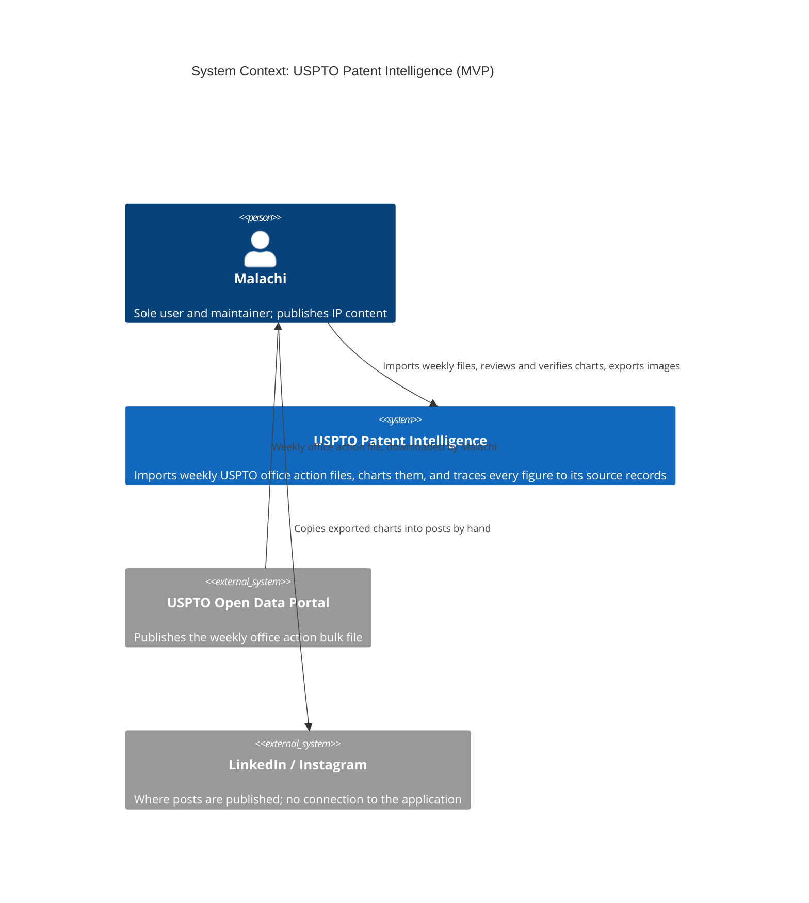
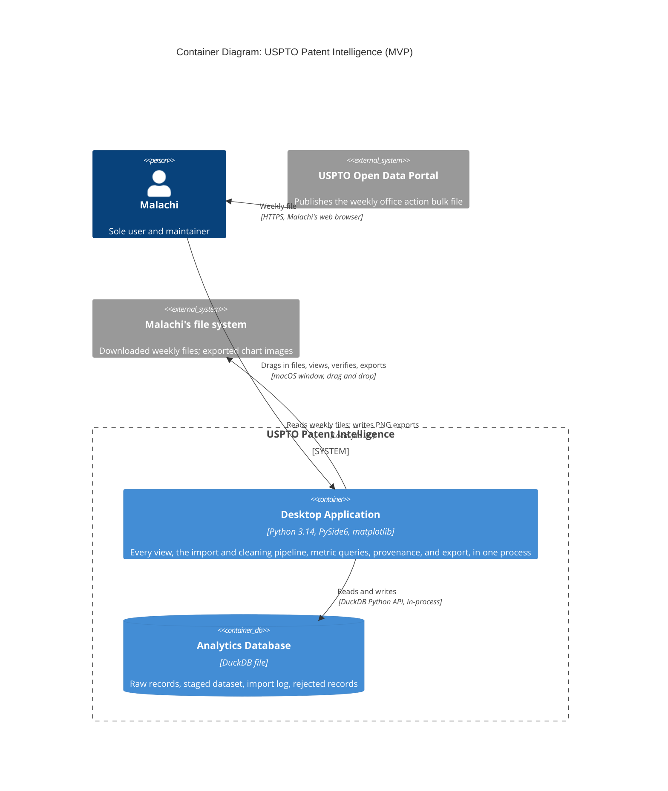
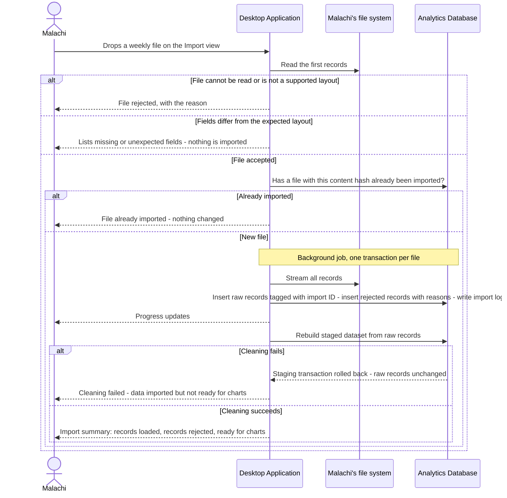

# Architectural Design

**Project:** USPTO Patent Intelligence
**Team:** 06
**Client:** Malachi Hernandez (personal project)
**Version:** 0.2

---

_**How to use this template.** Instructions appear in italic square brackets. Fill in underneath them and leave them in place until the document is stable. Every section says which checkpoint it is due at. A section that is not due yet stays as it is; do not fill it with guesses to make the document look finished._

_**What this document is.** Your system's **architecture-of-record**: the one map of the whole system, every use case area, every component, every external system, and the few decisions that are expensive to change later. It is **breadth-complete and depth-shallow**. Every part of the system is named, and nothing is designed further than its responsibility. How one use case works inside its component is a design-of-record, which comes in week 7, one per use case area, and it is written against real code._

_**What it is not.** A second copy of your requirements. The specification says what the system must do and how well; this document says how the system is shaped to do it. It **cites** `UC-*`, `CO-*`, `SEC-*`, `PER-*` and the rest by identifier and never restates them. A threshold that appears here and nowhere in the specification is a requirement hiding in the wrong document._

_**The test for what belongs here.** Decide now what is hard to reverse, affects the whole system, and is forced by a quality attribute or a constraint: how many deployables, where the data lives, how users sign in, which external systems you depend on. Leave to per-area design what is local and cheap to change: class names, endpoint shapes, table columns._

_**Structure.** The sections follow **arc42** (Starke and Hruschka), with **C4** diagrams (Simon Brown) for context and containers, written as mermaid so they diff in git. All twelve arc42 sections are here in arc42's order, numbering, and titles. The three subsections whose content another document already owns (the requirements overview, the stakeholders, and the quality requirements overview) are kept as one-line links to that document, so the numbering matches arc42's and nothing is written twice. arc42 orders sections by topic, not by when you write them, so Checkpoint 1 covers sections 1–5, 8, and 9, and sections 6 and 7 come later. The full worked example is Project Pulse's [architecture-of-record](https://github.com/Washingtonwei/project-pulse/blob/main/docs/design/architectural-design.md); read it for the shape, then write your own, because your client's quality attributes are not Project Pulse's.]_

> **Note on this draft.** At the team's request, sections 6, 7, 10.2, and 11 are drafted ahead of their checkpoints. They describe the **planned** design, are marked *provisional*, and must be redrawn against real code once the proving slice (`UC-FEAT-decompile-files`) exists.

## Identifiers

_[The new identifiers this document creates. Everything else it cites keeps the identifier of the document that owns it.]_

| Space | For | Example |
|---|---|---|
| `KD-<slug>` | Key architectural decisions | `KD-deployment-shape` |
| `QS-<slug>` | Quality scenarios | `QS-chart-traces-to-records` |
| `RISK-<slug>` | Technical risks | `RISK-format-drift` |
| `TD-<slug>` | Technical debt the architecture knowingly carries | `TD-macos-only` |

_[These are slugs, like every other identifier in your project, so an inserted decision renumbers nothing and a citation says what it points at. Project Pulse uses the same form: `KD-modular-monolith`, `QS-cross-team-denial`.]_

## Revision History

| Version | Date | Author | Change |
|---|---|---|---|
| 0.1 | 2026-10-27 | Cody Pinkston | Initial draft for Checkpoint 1; sections 6, 7, 10.2, and 11 drafted early as provisional |
| 0.2 | 2026-10-28 | Cody Pinkston | Python version changed from 3.12 to 3.14 (team decision) |

---

## 1. Introduction and Goals

_Due: Checkpoint 1._

### 1.1 Requirements overview

_[Your [specification](../requirements/software-requirements-specification.md) and your [use cases](../requirements/use-cases.md) are the requirements overview. Link them here; do not summarize them.]_

See the [software requirements specification](../requirements/software-requirements-specification.md) and the [use cases](../requirements/use-cases.md). MVP scope is section 4.3 of [vision and scope](../requirements/vision-and-scope.md).

### 1.2 Quality goals

_[The **three** quality attributes that most shape your system, in priority order. Pick them from section 9 of your [specification](../requirements/software-requirements-specification.md) and cite their identifiers. If you cannot rank them, ask your client which one they would give up first; that answer is the ranking._

_These are usually the top rows of the table in section 9.1, and the two do different jobs. Here, say why each goal matters to your client. There, say which decision it forces.]_

| Priority | Quality goal | Specification handles | Why it shapes the architecture |
|---|---|---|---|
| 1 | Every published figure can be traced back to the records it came from | `SAF-evidence-required`, `DI-source-tracking` | Malachi's readers include USPTO, Congress, and State Department staff. One figure he cannot back up damages the credibility of the whole series, and the client called "doesn't guess, makes concrete claims directly on the data" non-negotiable. |
| 2 | The application does not break when the data is messy or changes | `ROB-bad-input`, `ROB-format-change`, `ROB-resume` | The USPTO publishes a raw dump, its own fields disagree with each other (`RI-Inconsistent-Source-Fields`), and it can change the layout without notice (`RI-Format-Drift`). A silently dropped field corrupts every chart built afterward. |
| 3 | A non-programmer can install, run, and maintain it | `USE-zero-config`, `CO-single-maintainer`, `OE-no-manual-dependencies` | Malachi is the only user and the only maintainer after December, and he does not write code. Anything that needs a terminal, a server, or a second runtime will stop working after hand-off. |

### 1.3 Stakeholders

_[Your stakeholders are profiled in section 3.1 of [vision and scope](../requirements/vision-and-scope.md). Link it here; do not copy it.]_

See section 3.1 of [vision and scope](../requirements/vision-and-scope.md).

## 2. Architecture Constraints

_Due: Checkpoint 1._

_[The constraints the architecture has to honor. They are already written as `CO-*` in section 2.4 of your specification, and `OE-*` in section 2.3; **list the identifiers here, do not restate them.** Add one sentence only where a constraint narrows an architectural choice in a way that is not obvious from its text._

_Your technology stack is a constraint only if something external fixes it: the client's IT department, an existing system, or the person who maintains this after you graduate. A stack your team chose is a decision, and it goes in section 9 with the alternative you rejected.]_

**Constraints (`CO-*`):**

- `CO-local-execution`, `CO-no-paid-ai-services`, `CO-zero-recurring-cost`: together they rule out any hosted component, so every container in section 5.1 runs on Malachi's computer.
- `CO-single-maintainer`: rules out anything Malachi would have to operate himself, including a database server, Docker, or a second language runtime.
- `CO-layer-separation`: satisfied as separate Python packages inside one process (section 5.2), not as separate services; each package is tested on its own (`MNT-layer-tests`).
- `CO-bulk-data-first`: the MVP reads downloaded files only; the USPTO API (`SI-uspto-api`) is not built in the MVP.
- `CO-technology-evaluation`: the technology choices are recorded with their rejected alternatives in section 9.2.
- `CO-open-weight-models`, `CO-swappable-models`, `CO-model-licensing`: apply only to AI features, which are not in the MVP (`KD-no-ai-in-mvp`).

**Operating environment (`OE-*`):**

- `OE-client-machine`, `OE-minimum-hardware`, `OE-offline-operation`, `OE-no-manual-dependencies`.
- `OE-desktop-os`: the specification lists macOS and Windows, but section 4.3 of vision and scope puts Windows out of scope. The architecture targets **macOS on Apple silicon only**, and uses only cross-platform libraries so Windows remains possible later (`TD-macos-only`). The specification should be updated to match.
- `OE-hardware-adaptive`: in the MVP this applies only to processing (memory limits for DuckDB, section 8.2.8); model selection is deferred with AI.

## 3. Context and Scope

_Due: Checkpoint 1._

_[One C4 context diagram: your system as a single box, every kind of user, and **every external system** it talks to (email, payment, an identity provider, a client database, an LLM, a file store). An external system discovered halfway through the build is a schedule risk you could have seen at the start._

_Your specification already lists the external systems. Every system named in a software interface (`SI-*`, section 8.3), a communications interface (`CI-*`, section 8.5), or a dependency (`DE-*`, section 2.5) is a box here. A box with none of those behind it is an interface your specification is missing, so add it there too._

_This is your project's one context diagram. Section 4.1 of [vision and scope](../requirements/vision-and-scope.md) holds the first draft: redraw it here in C4, then replace the drawing there with a link to this section, so there is one diagram to keep current._

_arc42 divides context into a **business context** (who and what crosses the boundary) and a **technical context** (the channels and protocols). This diagram is the business context. The protocols go on the arrows of the container diagram in section 5.1._

_The **trust boundary** is not drawn here. You name it in writing in section 8.1, as Project Pulse does.]_

The only external system the MVP depends on is the USPTO Open Data Portal, and only indirectly: Malachi downloads the file and gives it to the application (`SI-uspto-bulk-files`, `DE-uspto-bulk-data`). Nothing crosses the boundary outward except files Malachi exports to his own disk (`CI-no-external-messages`).

**Interfaces in the specification that are not in the MVP**, and are added to this diagram when their feature is built:

| Interface | Why it is not in the MVP |
|---|---|
| `SI-uspto-api`, `DE-uspto-api`, `DE-uspto-api-outages` | `CO-bulk-data-first`; downloading stays manual (vision and scope 2.5) |
| `SI-local-ai-runtime`, `DE-local-llm-runtime` | `KD-no-ai-in-mvp` |
| `DE-uspto-grant-data`, `DE-litigation-data` | `FEAT-Link-Datasets` is out of scope (vision and scope 4.3) |

## 4. Solution Strategy

_Due: Checkpoint 1._

_[Three to five bullets: the few moves that shape everything else. arc42 suggests four kinds: the technology you build on, how the system is divided at the top level, how the quality goals in section 1.2 are met, and any organizational choice that shapes the code (who maintains what, what you buy instead of build)._

_Each bullet is one sentence, and it cites what explains it: the key decision in section 9.2 where one exists, and otherwise the quality goal and the building block in section 5 it shapes. Keep it short; the reasoning lives in section 9. A bullet that cites nothing is either not load-bearing, or it is a decision you have not written down yet.]_

- **One Python desktop application with an embedded DuckDB file**, packaged as a single macOS app, so there is nothing for Malachi to install, start, or operate (`KD-deployment-shape`, `KD-embedded-duckdb`, `KD-packaging-pyinstaller`; quality goal 3).
- **A native PySide6 window with matplotlib charts**, so multi-gigabyte files are read where they sit rather than uploaded, and clicking a chart point can open its records (`KD-ui-framework`; quality goals 1 and 2).
- **Raw records are stored exactly as read and never changed; cleaning produces a separate staged dataset**, and each file is validated before anything is loaded (`KD-raw-and-staged`; quality goal 2, `BR-no-data-alteration`).
- **Every chart is the result of a named SQL query over the staged data**, and the same query, asked for row keys, is what the Provenance component uses to show the records behind a figure (`KD-charts-from-sql`; quality goal 1).
- **No AI in the MVP**, so the deliverable is a working import, chart, verify, and export pipeline first (`KD-no-ai-in-mvp`).

## 5. Building Block View

_Due: Checkpoint 1. This section is most of what your TA checks._

### 5.1 Containers

_[One C4 container diagram: the separately running or separately stored pieces inside your system box. For most projects that is a front end, a back end, and a database, and sometimes a file store. Name each container's technology. Every external system from section 3 appears again here, attached to the container that talks to it._

_Label every arrow with what it does and the protocol it uses ("Sends confirmations [SMTP]"). Those protocols are arc42's technical context._

_Under the diagram, one or two sentences on **why the system is divided this way**, citing `KD-deployment-shape`. A reader who sees three containers should not have to guess why there are not seven._

_Three containers is a normal answer. If you have more than five, check each one against section 9: which decision, driven by which quality attribute, requires it to run separately?]_

The system is one application and one database file because Malachi has to be able to run and maintain it without operating anything (`KD-deployment-shape`). The database is a separate container only because it is separately stored: DuckDB runs inside the application's process, and the file is the one thing that survives a restart or an update (section 7).

### 5.2 Use case areas and components

_[One row per use case area in your [use cases](../requirements/use-cases.md), taken from the area column of [traceability.md](../traceability.md) section 1, plus one row per **cross-cutting component** that no single area owns (authentication, notifications, file handling, an integration with an external system). A use case area with no row is a part of your system with no home; a component with no area and no cross-cutting reason is one nobody asked for._

_**Responsibility** is one sentence, what the component owns, not how it works. **Depends on** names other components and external systems, never classes. **Status** is `provisional` until the component has been built through at least one use case, and `proven` after that. At Checkpoint 1 every row is `provisional`; Checkpoint 2 turns at least one to `proven`._

_Project Pulse's component tables also name each component's package. They can because its code exists; yours does not yet, so a row here is a name and a responsibility, and packages come with the design-of-record in week 7.]_

Every use case currently shares the area code `FEAT` ([use-cases.md](../requirements/use-cases.md) section 3), so the area column below names the feature area and its use cases.

| Use case area | Component | Responsibility | Depends on | Status |
|---|---|---|---|---|
| `FEAT` data intake (`UC-FEAT-decompile-files`) | Ingestion | Owns reading a weekly file, checking it against the expected layout, and loading its records unchanged, with every rejected record and its reason | Storage, Job Runner, Malachi's file system | provisional |
| `FEAT` data intake (`UC-FEAT-clean-data`) | Cleaning | Owns building the staged dataset from raw records using only the permitted cleaning operations | Storage, Job Runner | provisional |
| `FEAT` visualization (`UC-FEAT-create-visuals`) | Analytics | Owns the definition of every metric as a named query over the staged dataset | Storage | provisional |
| `FEAT` visualization (`UC-FEAT-create-visuals`, `UC-FEAT-export-visuals`) | Charts and Export | Owns turning metric results into charts, and writing labeled chart images to disk | Analytics, Malachi's file system | provisional |
| `FEAT` source verification (`UC-FEAT-verify-source`) | Provenance | Owns answering "which records, from which file, produced this chart or data point" | Analytics, Storage | provisional |
| `FEAT` local AI assistant (`UC-FEAT-query-ai`) | AI Assistant | Not built in the MVP (`KD-no-ai-in-mvp`); when added, answers questions only from records Provenance returns | Provenance, local AI runtime | deferred |
| (cross-cutting) | Desktop UI | The only component Malachi interacts with; owns the views in `UI-main-views` and calls the other components | Every component above | provisional |
| (cross-cutting) | Storage | The only component that opens the DuckDB file; owns the schema and its migrations | Analytics Database | provisional |
| (cross-cutting) | Job Runner | Runs long tasks one at a time off the UI thread, reports progress, and resumes after interruption (`USE-progress`, `ROB-resume`) | Storage | provisional |
| (cross-cutting) | Settings and Data Management | Owns the data folder location, disk usage, and dataset deletion (`DI-storage-visibility`, `DI-disposal`) | Storage | provisional |

_[Check before Checkpoint 1: every area in your use case file appears in the first column, and every external system in section 3 appears in some Depends on cell.]_

The USPTO Open Data Portal is reached only through Malachi's download, so the component that depends on it is Ingestion, through the downloaded file.

## 6. Runtime View

_Due: Checkpoint 2. [One sequence diagram, for the use case your proving slice builds, from the user's action through every container and external system it touches. Leave this section empty until the slice exists; a sequence diagram of code nobody has written describes a guess._

_Draw it as a mermaid `sequenceDiagram`, and name the participants exactly as the containers in section 5.1 name them. If the use case calls an external system, show what happens when that system fails or does not answer; arc42 counts error scenarios among the most useful runtime views. Under the diagram, a sentence or two on anything a reader would not guess from it. Cite the use case by its `UC-*` identifier; do not restate its steps.]_

**Provisional:** drawn before the slice is built, at the team's request. Redraw it against the code when `UC-FEAT-decompile-files` is complete.

Proving slice: `UC-FEAT-decompile-files`, followed automatically by `UC-FEAT-clean-data`.

The raw load is one transaction per file, so a crash or a quit during import leaves the database as it was before that file, and the file is simply imported again on the next attempt (`ROB-resume`, `DI-no-duplicates`). Rejected records do not fail the file; they are counted and kept with their reason so that loaded plus rejected always equals the records in the file (`SM-Complete-Intake` in vision and scope).

## 7. Deployment View

_Due: Checkpoint 3. [Filled in once your pipeline exists, after week 11. Three things:_

- _**Where each container runs.** Every container in section 5.1 is mapped to the host, service, or device it runs on, in each environment you have (at least development and production). A table is enough; a diagram helps once there are more than two hosts._
- _**How a change gets there.** From a merged pull request to production: what builds it, what tests it, and where it is released first._
- _**What survives a restart.** Which state is in the database or a file store, and which is lost when the application restarts._

_Section 4.4 of [vision and scope](../requirements/vision-and-scope.md) says who can operate the system and where its users are. Cite it; this section says how the deployment meets it.]_

**Provisional:** the pipeline does not exist yet. This is the plan the team agreed on 2026-10-27.

**Where each container runs**

| Environment | Desktop Application | Analytics Database |
|---|---|---|
| Development | Each team member's laptop (macOS or Windows), run from source in a Python 3.12 virtual environment | A DuckDB file in a local, git-ignored data folder; the full sample weekly file stays in the git-ignored `example data/` folder |
| Continuous integration | GitHub Actions runners: tests on every pull request; the macOS (Apple silicon) runner builds the app | A temporary DuckDB file created by the tests from small fixture files |
| Production | Malachi's 2022 MacBook Air (Apple silicon), as a macOS app in Applications | One DuckDB file in the application's data folder under `~/Library/Application Support` |

**How a change gets there**

1. A pull request runs `ruff` and `pytest` on GitHub Actions. It cannot merge until they pass and it has the reviews `team-contract.md` section 5 requires.
2. A release is a version tag on `main`. The tag triggers a macOS Apple silicon runner that builds the app with PyInstaller (`KD-packaging-pyinstaller`) and attaches it to a GitHub Release.
3. Malachi downloads the release and drags the app into Applications. The app is unsigned unless the code-signing question in section 11 of the specification is resolved, so the first launch needs the macOS "Open anyway" step, which the user guide describes (`MNT-user-guide`, `RISK-unsigned-app`).
4. On first start after an update, Storage applies any pending schema migrations to the existing database file.

This meets section 4.4 of vision and scope: it runs only on Malachi's machine, he installs it himself, and nothing is hosted.

**What survives a restart**

| Survives | Lost |
|---|---|
| Everything in the DuckDB file: raw records, staged dataset, import log, rejected records | Charts on screen (they are recomputed from the database) |
| Exported chart images, in the folder Malachi chose | An import in progress: its transaction is rolled back, and the file is imported again |
| Settings (data folder location) | |

## 8. Crosscutting Concepts

_[arc42 leaves this section an open list of concepts. This template fixes its first entry, 8.1 Security, because Checkpoint 1 asks for the trust boundary; 8.2 holds every other concept.]_

### 8.1 Security

_Due: named at Checkpoint 1, detailed at Checkpoint 2._

_[Four short paragraphs. The last three each cite the `SEC-*` requirement they answer:_

- _**Trust boundary:** the line between what you control and what you do not. Name the container that is the boundary and what sits outside it (the browser, every external system). Every request that crosses it is authenticated and authorized, and it covers every path your deployable answers, framework endpoints included. Project Pulse's Security & Compliance section shows the shape in three sentences._
- _**Authentication:** how a user proves who they are, and who issues the credential (your system, the client's sign-on, a third party)._
- _**Authorization:** the roles, and the rule for what a user may see beyond their role (a patron sees only their own orders). The second part is where most real breaches happen._
- _**Sensitive data:** what personal or regulated data the system stores, in which container, and which external systems receive any of it. How long it is kept and how it is disposed of are already in section 7.4 of your specification; cite them._

_Secrets (passwords, API keys, connection strings) never appear in this document or in the repository. Say where they will live, not what they are.]_

**Trust boundary.** The Desktop Application is the boundary. Outside it are the weekly files Malachi imports, which are untrusted input: they are parsed as data, checked against the expected layout before loading, and never executed. The application opens no network ports and makes no network connections in the MVP, so there is no request path into it other than Malachi's own window (`SEC-local-services`, `SEC-no-data-egress`, `SEC-no-telemetry`).

**Authentication.** None. The application is single-user and relies on Malachi's macOS account to control who can open it and its data folder (`SEC-no-login`).

**Authorization.** One user with one role, who may see and do everything. There is no other user whose data needs to be kept apart.

**Sensitive data.** The data is public (`AS-public-data`), but each office action carries the examiner's employee number, which identifies a real person (`DI-identifiable-people`, `RI-Examiner-Identification`). It is stored only in the Analytics Database on Malachi's computer, and no external system receives it. Retention and disposal follow `DI-retention` and `DI-disposal`. Examiner numbers are never written to the log (section 8.2.7). The MVP has no secrets; when the USPTO API is added, its key goes in the macOS Keychain (`SEC-credential-storage`).

### 8.2 Other concepts

_Due: Checkpoint 1, a subsection for every concept in the table below; then kept current, adding the file that shows each rule once code exists and a new concept whenever one appears. [Anything every component must do the same way. Your agent starts every session with no memory of the last, so a convention that is not written here gets reinvented each time. Write every concept now, while each is still cheap to choose; the last column says when a missing one would start to hurt._

_One short subsection each: the rule in one sentence, why, and the file that shows it done right once one exists. Put the one-line instruction in your charter too, citing this subsection, because the charter is what your agent always reads. Project Pulse's Crosscutting Concepts section is a worked example; its headings differ from this template's.]_

| Concept | The question it settles | When it usually bites |
|---|---|---|
| _Error handling_ | _What does a failure look like to the caller, and where is it caught?_ | _The second endpoint_ |
| _Time and time zones_ | _Whose clock decides a deadline, what zone is stored, and can a test set the time?_ | _The first deadline or "submitted late"_ |
| _API conventions_ | _What shape does every response take, and how are endpoints named?_ | _The second endpoint_ |
| _Code conventions_ | _Which libraries and idioms does every file use, and which are banned? (Formatting belongs to a formatter, not here.)_ | _The first file an agent writes_ |
| _Validation_ | _Where is input checked, and which check is the one that counts?_ | _The first form_ |
| _Configuration and secrets_ | _What differs between development and production, and where does it live?_ | _The first deploy_ |
| _Logging_ | _What is logged, at what level, and what must never be?_ | _The first bug you cannot reproduce_ |
| _Persistence and concurrency_ | _Where does a transaction begin and end, and what happens when two people edit at once?_ | _The first shared record_ |
| _Auditing_ | _Who changed what, and when?_ | _The first "who did this?"_ |
| _Testing_ | _Which kinds of test, at which layer, with what data?_ | _The first pull request_ |

**8.2.1 Error handling.** Components raise the application's own exception types for failures the user must act on (an unreadable file, a changed layout, a failed cleaning run), and the Desktop UI catches them in one place per action and shows a plain-English message; a problem with a single record is never an exception, it is a rejected record with a reason. Why: the client requires the application not to break on bad data, and every rejected record has to be counted, not lost. No message shown to the user contains a stack trace; the trace goes to the log. Shown in: not yet written.

**8.2.2 Time and time zones.** Timestamps are stored in UTC exactly as the USPTO supplies them (for example `2026-10-14T16:06:10.000Z`), dates such as the filing date are stored as dates, and everything is displayed as YYYY-MM-DD (specification section 10). Why: the source is UTC, and the only clock the application itself reads is the import time. That time is passed in as a parameter, so tests can set it. Shown in: not yet written.

**8.2.3 API conventions.** There is no network API. Between components, the Desktop UI calls each component's public functions, which return plain Python data classes or small tables, and only Storage creates DuckDB connections; other components receive a cursor from it. Why: one owner for the database file is what makes `CO-layer-separation` testable and avoids two writers. Section 8.4 of the specification (API document) is satisfied by the docstrings of those public functions. Shown in: not yet written.

**8.2.4 Code conventions.** Python 3.14; `ruff` formats and lints every file and runs in CI; public functions have type hints; one package per component in section 5.2; names use the [glossary](../requirements/project-glossary.md) terms (Office Action, Art Unit, Technology Center, Rejection). Bulk work is done in DuckDB SQL, not by loading whole files into pandas; pandas is acceptable only for small query results. No network library is imported anywhere in the MVP (`SEC-no-data-egress`). Shown in: not yet written.

**8.2.5 Validation.** The check that counts is in Ingestion: before loading, a file is compared with the expected field list for its layout, and while loading, each record is checked for the fields every chart needs (record ID, application number, art unit, document code, submission date). The Desktop UI checks only that a file was chosen. Why: one place decides what "valid" means, so a changed USPTO layout is caught once, before anything is stored (`ROB-format-change`). Shown in: not yet written.

**8.2.6 Configuration and secrets.** The only setting that differs between development and production is the data folder: production uses the application's folder under `~/Library/Application Support`, and development overrides it with an environment variable. Settings are kept in a small file in that folder. The MVP has no secrets; any future secret goes in the macOS Keychain, never in a file or the repository. Shown in: not yet written.

**8.2.7 Logging.** The application writes a rotating log file with Python's `logging` module: INFO for the start, end, and record counts of each import and cleaning run; WARNING for rejected-record summaries; ERROR with a stack trace for failures. It never logs office action text, whole records, or examiner numbers, and it sends nothing anywhere (`SEC-no-telemetry`). Why: Malachi can send the log file to whoever helps him, without it containing the data. Shown in: not yet written.

**8.2.8 Persistence and concurrency.** One process and one DuckDB connection, owned by Storage. Long tasks run one at a time on the Job Runner's background thread, and the UI reads with its own cursor. Importing one file is one transaction, and rebuilding the staged dataset is another. Raw tables are append-only: no code updates or deletes raw records except a full dataset deletion (`BR-no-data-alteration`, `DI-disposal`). DuckDB's memory limit and temporary folder are set at start-up from the computer's available memory, so large files spill to disk instead of exhausting memory (`OE-hardware-adaptive`). Schema changes are numbered migration scripts that Storage applies on start-up. Shown in: not yet written.

**8.2.9 Auditing.** Every import writes an import log entry: file name, content hash, import time, records loaded, records rejected, and application version, and every raw record carries the ID of the import that loaded it (`DI-source-tracking`). Why: this is the paper trail the client asked for; it is what Provenance shows. There is only one user, so there is no "who" to record beyond the import. Shown in: not yet written.

**8.2.10 Testing.** `pytest`, with three layers: unit tests per component (`MNT-layer-tests`); integration tests that import a small fixture file, build the staged dataset, run a metric, and check that Provenance returns exactly the records counted; and a few UI smoke tests. Fixture files are a few dozen records cut from the sample weekly file, including deliberately malformed ones, and are committed under the tests folder; the full sample file is git-ignored and is used only for manual accuracy checks (`SM-Accuracy`). Shown in: not yet written.

## 9. Architecture Decisions

_Due: the table and one decision at Checkpoint 1; more as they are made._

### 9.1 Architecturally significant requirements

_[Not every requirement shapes the architecture. The **architecturally significant requirements** are the few that do: quality attributes and constraints where a wrong guess costs a redesign, not a bug fix. Functionality can be delivered by many structures; these are what choose among them._

_Your quality goals from section 1.2 are usually the top rows; cite them by identifier and do not explain them again. This table can also hold what is nobody's goal but still forces structure, such as a `CO-*` constraint._

_List three to six, ranked by importance to your client times difficulty to achieve. Reuse the specification's identifiers, never new ones. **At least one row is a `SEC-*` attribute.** Every system your team builds this year holds some personal data, and if no security requirement appears here, that data's protection was never designed; it will be added later, which is where security bugs come from.]_

| Rank | Requirement | Specification handles | Importance × difficulty | Drives |
|---|---|---|---|---|
| 1 | Every figure traceable to its records | `SAF-evidence-required`, `DI-source-tracking` | High × Medium | `KD-charts-from-sql`, `KD-raw-and-staged` |
| 2 | Survives messy, changed, or interrupted input | `ROB-bad-input`, `ROB-format-change`, `ROB-resume` | High × High | `KD-raw-and-staged`, `KD-embedded-duckdb` |
| 3 | Non-programmer installs and maintains it | `USE-zero-config`, `CO-single-maintainer`, `OE-no-manual-dependencies` | High × Medium | `KD-deployment-shape`, `KD-packaging-pyinstaller` |
| 4 | Weekly volume and years of history on one laptop | `SCA-weekly-volume`, `SCA-prosecution-history`, `PER-dashboard` | Medium × High | `KD-embedded-duckdb`, `KD-ui-framework` |
| 5 | No data leaves the computer | `SEC-no-data-egress`, `CO-local-execution` | High × Low | `KD-deployment-shape`, `KD-no-ai-in-mvp` |

### 9.2 Key decisions

_[One entry per key decision (`KD-*`), in the form below; it is what the wider industry calls an architecture decision record (ADR). Checkpoint 1 requires exactly one: **`KD-deployment-shape`**, whether your system ships as one deployable or several, and why. Every team makes this decision, and it is where over-engineering usually shows up first. Add others when you make them; do not invent them to fill the section._

_A decision without a **rejected alternative** is not a decision, it is a description. Name what you did not do and why not, so the next person does not redo the argument._

_A decision that turns out wrong is not deleted or rewritten. Mark it **Superseded by `KD-<new-slug>`** and write the new decision as its own entry, so the reasoning behind both stays readable.]_

**`KD-deployment-shape`: one desktop application, one process.** _Accepted, 2026-10-27._

- **Driving requirements:** `CO-single-maintainer`, `USE-zero-config`, `OE-no-manual-dependencies`, `SEC-no-data-egress`.
- **Context:** One user on one MacBook, who maintains the application himself and does not write code. Weekly files of hundreds of megabytes, possibly tens of gigabytes.
- **Decision:** The user interface and all processing run in one Python process, packaged as one macOS app, with DuckDB embedded in that process and its data in one file.
- **Rejected:** A local web server with a browser front end (Streamlit, Dash, or NiceGUI in browser mode). Browser uploads copy the whole file, which fails for multi-gigabyte files, and it adds a server process and an open port. Also rejected: a Python back end with an Electron front end (the napkin's proposal). That is two runtimes to package and two languages for one maintainer, plus a contract between them that nobody owns.
- **Trade-off:** A crash anywhere takes down the window, and long imports must run on a background thread so the window stays responsive.

**`KD-ui-framework`: PySide6 with embedded matplotlib charts.** _Accepted, 2026-10-27._

- **Driving requirements:** `UI-main-views`, `UI-drag-and-drop`, `FEAT-Verify-Source`, `INT-export`.
- **Context:** The team writes Python only. The UI must accept large files by drag and drop, open the records behind a clicked chart point, and produce clean PNG images for LinkedIn.
- **Decision:** PySide6 (Qt for Python) for every view. Charts are matplotlib figures embedded in the window, and record lists are Qt tables that fetch rows from DuckDB on demand.
- **Rejected:** NiceGUI in native-window mode, the runner-up: quicker to build, but files would come through a file dialog or a browser upload rather than native drag and drop. Streamlit and Dash: browser-based, see `KD-deployment-shape`. Tkinter: weak charting and large-table support. Flet and Toga: young projects whose APIs still change. PyQt6: same toolkit as PySide6, but GPL or paid licensing.
- **Trade-off:** Qt has a steeper learning curve and wordier code than the web-style alternatives. matplotlib charts are less interactive than browser charts (no rich hover), in exchange for what Malachi sees being exactly what he exports.

**`KD-embedded-duckdb`: DuckDB as a local database file.** _Accepted, 2026-10-27 (team decision)._

- **Driving requirements:** `SCA-weekly-volume`, `SCA-prosecution-history`, `PER-dashboard`, `OE-no-manual-dependencies`.
- **Context:** Analysis is counting and grouping millions of records over years of weekly files. The sample weekly file is one JSON record per line, which DuckDB reads directly.
- **Decision:** One DuckDB file holds all data, opened in-process through DuckDB's Python API. The DuckDB version is pinned.
- **Rejected:** SQLite, which stores rows rather than columns, is much slower at the large scans and grouping the charts need, and has no direct reader for the weekly file. PostgreSQL, a server Malachi would have to install and run. Plain Parquet files with pandas: no transactions, and the team would have to build provenance tracking itself.
- **Trade-off:** Only one process may write to the file at a time, which `KD-deployment-shape` already guarantees. A DuckDB upgrade must be tested against an existing database file before release (`RISK-duckdb-upgrade`).

**`KD-raw-and-staged`: keep raw records unchanged; derive a staged dataset.** _Accepted, 2026-10-27._

- **Driving requirements:** `BR-no-data-alteration`, `ROB-bad-input`, `ROB-format-change`, `DI-source-tracking`.
- **Context:** The cleaning rules are still open (`OI-4`, `OI-5`), the USPTO's own fields disagree (`RI-Inconsistent-Source-Fields`), and the team decided on 2026-10-27 to keep the full office action text so rejections can be counted from the text as well as the tags.
- **Decision:** Ingestion validates each file before loading, then loads its records unchanged, including the office action text, into append-only raw tables tagged with the import ID. Cleaning builds the staged dataset from the raw tables, and it can be rebuilt at any time. Charts read only the staged dataset.
- **Rejected:** Cleaning in place, as records are loaded. It destroys the evidence that a figure is right, and when a cleaning rule changes the data would have to be imported again.
- **Trade-off:** More storage, since the raw text is kept and some fields exist in both raw and staged form (`RISK-storage-growth`). Where possible, staged data is a view rather than a copy.

**`KD-charts-from-sql`: every chart is a named query; provenance re-runs it.** _Accepted, 2026-10-27._

- **Driving requirements:** `SAF-evidence-required`, `FEAT-Verify-Source`, `UC-FEAT-verify-source`.
- **Context:** Malachi must be able to open the records behind any figure before he publishes it.
- **Decision:** Analytics defines each metric as a named, parameterized SQL query over the staged dataset. A chart records its metric name, parameters, and the import IDs it covers. Provenance runs the same query filtered to the selected data point and returns record keys and source files instead of counts. Each chart is labeled with the field it counts, for example rejection tag or rejection text.
- **Rejected:** Computing figures in Python inside the chart code, where the link between a number and its records is lost. Pre-computed summary tables only, which cannot be drilled into.
- **Trade-off:** Every metric must be expressible in SQL, and drilling into a large data point re-runs a query.

**`KD-no-ai-in-mvp`: no AI features in the MVP.** _Accepted, 2026-10-27 (team decision)._

- **Driving requirements:** vision and scope 4.3; `RI-Unsupported-Claims`, `RI-Local-AI-Too-Slow`.
- **Context:** The client wants AI analysis only if it never states something the data does not support, and a model that runs well on his MacBook Air is unproven.
- **Decision:** No AI runtime or model is bundled, and `UC-FEAT-query-ai` is not built. The AI Assistant component stays in section 5.2 as deferred.
- **Rejected:** Bundling a local runtime (such as Ollama) now. It adds a second process, multi-gigabyte model files, and the hardest packaging work, before the core pipeline exists.
- **Trade-off:** `SAF-ai-grounding`, `SI-local-ai-runtime`, `PER-ai-response`, `ROB-low-resources`, `CO-open-weight-models`, and `CO-swappable-models` are not met by the MVP. When AI is added, it answers only from records Provenance returns, so the other components do not change.

**`KD-packaging-pyinstaller`: PyInstaller app, built in CI on Apple silicon.** _Accepted, 2026-10-27._

- **Driving requirements:** `USE-zero-config`, `OE-no-manual-dependencies`, `CO-zero-recurring-cost`.
- **Context:** Malachi must install it without a terminal, and at least part of the team develops on Windows, so the Mac build must come from a Mac.
- **Decision:** PyInstaller produces the macOS app on a GitHub Actions Apple silicon runner when a release is tagged (section 7).
- **Rejected:** Briefcase, which has built-in signing support but fewer worked examples with PySide6. Shipping source code with `pip install` instructions, which needs a terminal.
- **Trade-off:** The app is large because it bundles Python, Qt, and DuckDB. It is unsigned unless someone pays for an Apple developer account (`RISK-unsigned-app`).

## 10. Quality Requirements

### 10.1 Quality requirements overview

_[Section 9 of your [specification](../requirements/software-requirements-specification.md) is the overview. Link it here; do not copy it.]_

See section 9 of the [software requirements specification](../requirements/software-requirements-specification.md).

### 10.2 Quality scenarios

_Due: one scenario at Checkpoint 2; one per top-ranked requirement in section 9.1 by Checkpoint 3._

_[A quality attribute says how good; a scenario says how you will know. Each one is: a **source** does a **stimulus** in an **environment**, the system gives a **response**, and a **measure** tells you it worked. The measure cites the specification's attribute for its number; it never introduces one._

_**Verified by** names the test, or the repeatable manual check, that shows the measure holds. Leave it empty until that test exists; an empty cell is an honest "not yet verified".]_

**Provisional:** none of these is verified yet, so the last column is empty.

| ID | Source and stimulus | Environment | Response | Measure | Verified by |
|---|---|---|---|---|---|
| `QS-chart-traces-to-records` | Malachi selects one bar in a rejection chart and asks for its source | One weekly file imported and staged | The records counted in that bar are listed, each with its source file and import date | The number of records listed equals the bar's value, and every record names its source file (`SAF-evidence-required`, `DI-source-tracking`) | |
| `QS-corrupt-file-reported` | Malachi imports three weekly files, one of them truncated | Normal operation | The two good files import; the truncated one is reported and none of its records are stored | No partial data from the bad file, and a report naming it (`ROB-bad-input`) | |
| `QS-changed-layout-refused` | Malachi imports a weekly file missing a field the charts need | Normal operation | The file is refused and the missing fields are listed | No records from that file reach the staged dataset or any chart (`ROB-format-change`) | |
| `QS-interrupted-import-resumes` | Malachi quits the application in the middle of importing a file | Import in progress | On restart, earlier files are intact and the interrupted file can be imported again | No duplicate records and no partial file (`ROB-resume`, `DI-no-duplicates`) | |
| `QS-fresh-mac-install` | A tester installs the released app on a Mac that has never had Python | Clean macOS account | The tester imports a weekly file and sees the Weekly Overview | No terminal or configuration step (`USE-zero-config`) | |
| `QS-no-network-traffic` | A tester runs import, chart, verify, and export while monitoring network traffic | Normal operation | The application works without any network connection | Zero connections opened by the application (`SEC-no-data-egress`) | |

## 11. Risks and Technical Debt

_Due: Checkpoint 2, kept current after._

_[**Technical** risks and debt only. Business risks are `RI-*` in [vision and scope](../requirements/vision-and-scope.md); do not copy them here. Project risks, such as a teammate dropping the course, belong in neither document. Seed this list from the technical `RI-*` items and from any [OPEN-ISSUES.md](../requirements/OPEN-ISSUES.md) entry whose answer could change the architecture._

_A **risk** might happen: an external system you have never called, a client dataset you have never seen. **Debt** has already happened: a shortcut you took on purpose and intend to pay back. Each row says how you would find out, or how you would fix it._

_A risk written as a category ("security", "performance") is not a risk. Write the mechanism: what fails, and what that breaks.]_

**Provisional:** seeded from vision and scope and OPEN-ISSUES before any code exists.

| ID | Type | What could go wrong, and what it breaks | Mitigation or fix | Cites |
|---|---|---|---|---|
| `RISK-format-drift` | Risk | The client brief describes ZIP and XML files, but the only sample is one JSON record per line. If other weeks, or older years, arrive in another layout, Ingestion cannot read them and history charts have gaps. | Ingestion has one reader per layout behind one interface. Ask the client for two or three more weekly files from different periods. | `RI-Format-Drift`, `AS-weekly-file-format`, `OI-6` |
| `RISK-large-file-memory` | Risk | The client mentions weekly downloads of 20–50 GB. Reading one into memory on a 24 GB laptop crashes the application part-way through. | Stream with DuckDB, with a memory limit and a spill folder (section 8.2.8). Test with a generated file larger than the computer's memory before release. | `SCA-weekly-volume`, `OE-client-machine` |
| `RISK-rejection-field-conflict` | Risk | The USPTO's rejection tags and the letter text disagree (the §102 undercount). If metrics use the wrong one, a published figure is wrong by more than three times. | Each metric is labeled with the field it counts (`KD-charts-from-sql`). The client decides which field is the source of truth. | `RI-Inconsistent-Source-Fields`, `OI-1` |
| `RISK-storage-growth` | Risk | Keeping the full office action text (`KD-raw-and-staged`) is about 20 GB a year before compression. Several years plus grant and litigation data could fill the drive. | Measure the compressed size of the sample in DuckDB early. Show disk usage and allow dataset deletion (`DI-storage-visibility`, `DI-disposal`). | `RI-Storage-Cost`, `SCA-storage-limit` |
| `RISK-unsigned-app` | Risk | macOS blocks unsigned apps on first launch, and Malachi may not get past the warning, which fails `USE-zero-config`. | Document the "Open anyway" step in the user guide. Ask the client whether a paid Apple developer account is acceptable under `CO-zero-recurring-cost`. | Specification section 11, `MNT-user-guide` |
| `RISK-duckdb-upgrade` | Risk | A new DuckDB version cannot open a database file written by an older release, so Malachi loses access to his history after an update. | Pin the DuckDB version. Before each release, CI opens a database file created by the previous release. | `KD-embedded-duckdb` |
| `TD-macos-only` | Debt | Only an Apple silicon macOS build is produced, although `OE-desktop-os` lists Windows. | All libraries are cross-platform; add a Windows build to CI when Windows comes into scope. | `OE-desktop-os`, vision and scope 4.3 |

## 12. Glossary

_[Domain terms live in your [project glossary](../requirements/project-glossary.md). Link it and add nothing here unless you need an architecture term your team uses in a special sense.]_

Domain terms are in the [project glossary](../requirements/project-glossary.md). Architecture terms used in a special sense here:

- **Import:** one weekly file loaded into the database; identified by an import ID and recorded in the import log.
- **Raw records:** records stored exactly as they appeared in the weekly file, never changed after loading.
- **Staged dataset:** the cleaned data derived from the raw records, which every chart reads.
- **Metric:** a named, parameterized query over the staged dataset that produces one chart's numbers.
- **Provenance:** the records and source files behind a chart or data point.
- **Proving slice:** the first use case built end to end through every container; here, `UC-FEAT-decompile-files`.

---

## Working this document with your agent

_[Delegate: drawing the C4 diagrams in mermaid from your use case list and your specification's interfaces; checking that every use case area has a component and every external system has a component that depends on it; checking that every identifier this document cites exists in the document that owns it; drafting the rejected alternative for a decision you have already made._

_Keep human: the ranking in section 9.1 and every `KD-*`. The decisions are the part of this document your client and the team that inherits this system will hold you to, and they depend on facts about your client that are not in any file._

_**The specific failure to watch for: over-engineering.** Ask an agent for an architecture and it will propose the one it has seen most often in writing, which is built for a company a thousand times your size: microservices, a message queue, Kubernetes, a cache in front of a database that holds ten thousand rows. Every one of those is a real answer to a problem you do not have, and each one adds something that can break at 2 a.m. with nobody to fix it. For every container and every decision the agent proposes, ask which requirement in section 9.1 forces it. If the answer is none, cut it.]_
