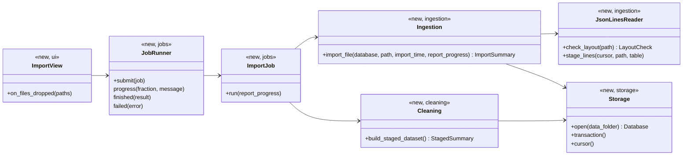
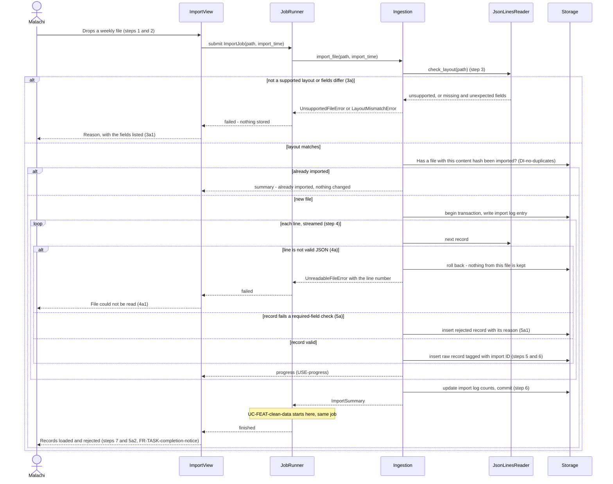
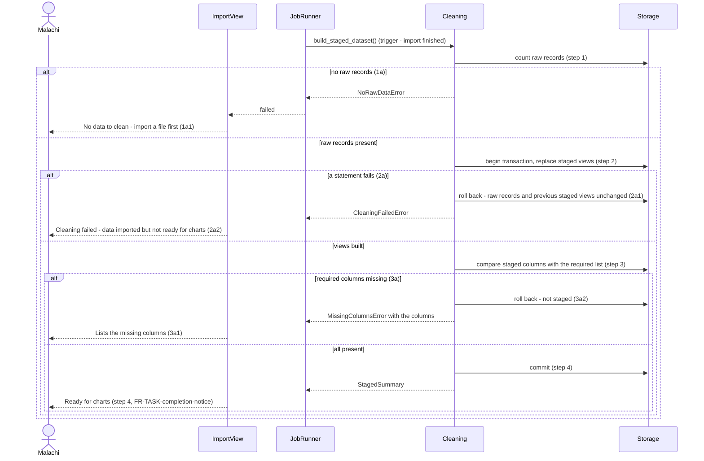
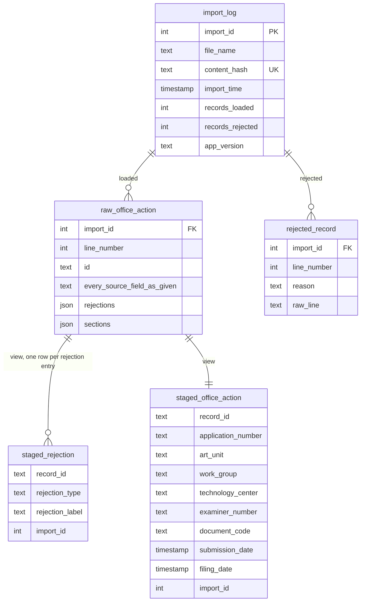

# Data Intake Design

**Project:** USPTO Patent Intelligence
**Team:** 06
**Area:** `UC-FEAT-*`, data intake (`FEAT-Intake-Data`). Every use case shares the area code `FEAT` ([use-cases.md](../requirements/use-cases.md) section 3), so the design documents are split by feature area, as [architecture 5.2](architectural-design.md#52-use-case-areas-and-components) does.

> **Realizes:** `UC-FEAT-decompile-files`, `UC-FEAT-clean-data`, `FR-TASK-completion-notice` (for import and cleaning)
> **Depends on:** `BR-no-data-alteration`, `BR-weekly-uspto-publication`, `BR-weekly-office-action-data`, `BR-art-unit-assignment`, `BR-office-action-issued`; `DI-source-tracking`, `DI-no-duplicates`, `ROB-bad-input`, `ROB-format-change`, `ROB-resume`, `USE-progress`, `SCA-weekly-volume`, `PER-incremental`, `SI-uspto-bulk-files`; `KD-deployment-shape`, `KD-embedded-duckdb`, `KD-raw-and-staged`
> **See:** [use cases](../requirements/use-cases.md), [specification](../requirements/software-requirements-specification.md) (5.2, 7.2), [architecture-of-record](architectural-design.md) (5.2, 6, 8.2)
> **Designed against:** `main` @ `b621e0b`. No application code exists yet; this is the proving slice, so every file below is new.

> **Status: draft.** Written by an agent at the team's request, before any code and before the questions test. Every point the specification did not settle is listed under [Open questions & risks](#open-questions--risks); none of them is decided until a teammate reviews this document.

---

## Overview

_[One paragraph: what this area does, which components of your [architecture-of-record](architectural-design.md) it lives in, and what it reads from or calls in other areas. Link the container diagram rather than redrawing it. If this design changes the architecture-of-record, say so here and list the change under "Changes to the architecture-of-record" below.]_

Data intake takes a weekly office action file that Malachi drops on the Import view, checks it, stores its records unchanged in the raw tables with every rejected record and its reason, and then builds the staged dataset that every chart reads. It lives in the **Ingestion** and **Cleaning** components ([5.2](architectural-design.md#52-use-case-areas-and-components)), runs on the **Job Runner**, and writes through **Storage**, all inside the Desktop Application container ([5.1](architectural-design.md#51-containers)). Because this is the proving slice, it also creates the cross-cutting pieces every later area reuses: the package layout, Storage with its first migration, the Job Runner, the shared error base, the application's settings, and the main window with the Import view. Cleaning starts by itself when an import finishes (the use case's trigger), so the two use cases are one background job from Malachi's point of view. This design follows the runtime view in [architecture section 6](architectural-design.md#6-runtime-view) and does not change the architecture.

## Components & classes

_[One class diagram for the whole area, and one line per class or file saying what it does and whether it is **new** or **reused**. Show only what a reader needs to see how the parts relate: classes, their key methods, their dependencies. Fields and getters belong to the code._

_**If your repository has no code for this area yet**, which is the normal case for your proving slice, list the files you expect the agent to create, with the paths your architecture-of-record's conventions give them, and mark them all new. The agent then builds into the structure you chose rather than one it improvised.]_

Package root: `src/patent_intelligence/`, one package per component ([8.2.4](architectural-design.md#82-other-concepts)). Tests mirror it under `tests/`.

- `ingestion/importer.py` (new): `import_file`. Receives the Storage handle ([8.2.3](architectural-design.md#82-other-concepts)), checks the layout, hashes the file, refuses a file already imported, then loads the records into the raw tables in one transaction and returns an `ImportSummary` (import ID, records loaded, records rejected, rejected records by reason).
- `ingestion/readers.py` (new): one reader per file layout behind one interface (`RISK-format-drift`). Release 1.0 has one, `JsonLinesReader`, for the one-JSON-record-per-line layout in [SRS 7.2](../requirements/software-requirements-specification.md#72-data-dictionary). `stage_lines` has DuckDB stream every line into a temporary table of line number and line text; the checks and inserts that follow are SQL over that table ([8.2.4](architectural-design.md#82-other-concepts)).
- `ingestion/layout.py` (new): the expected field list for each layout and the per-record checks of [8.2.5](architectural-design.md#82-other-concepts). This is the one place that defines "valid".
- `tests/fixtures/office_actions_20.jsonl` (new): 20 records from the sample, with placeholder examiner numbers and shortened letter text; how it was cut is in `tests/fixtures/README.md`.
- `ingestion/errors.py` (new): `UnsupportedFileError`, `LayoutMismatchError` (carries the missing and unexpected fields), `UnreadableFileError`.
- `cleaning/staging.py` (new): `build_staged_dataset`. Replaces the staged views in one transaction and checks they have the columns charts need.
- `cleaning/errors.py` (new): `NoRawDataError`, `CleaningFailedError`, `MissingColumnsError` (carries the column names).
- `storage/database.py` (new): opens the one DuckDB connection, sets the memory limit and spill folder from available memory, hands out cursors and transactions. The only module that imports `duckdb` connection functions ([8.2.3](architectural-design.md#82-other-concepts)).
- `storage/migrations/001_raw_tables.sql` (new): the tables in [Data model](#data-model). `storage/migrate.py` (new) applies numbered scripts on start-up ([8.2.8](architectural-design.md#82-other-concepts)).
- `jobs/runner.py` (new): `JobRunner`, one background thread, one job at a time, with Qt signals for progress, finished, and failed (`USE-progress`).
- `jobs/import_job.py` (new): runs `import_file`, then `build_staged_dataset`, for one file. Built with `UC-FEAT-decompile-files` it runs `import_file` only; `UC-FEAT-clean-data` adds the second call.
- `errors.py` (new): `AppError`, the base of every component's exceptions, with a plain-English `message` for the UI ([8.2.1](architectural-design.md#82-other-concepts)).
- `settings.py` (new): the data folder, from `~/Library/Application Support` in production or an environment variable in development ([8.2.6](architectural-design.md#82-other-concepts)).
- `logging_setup.py` (new): the rotating log file of [8.2.7](architectural-design.md#82-other-concepts).
- `ui/main_window.py` (new): the window and its view tabs (`UI-main-views`); catches `AppError` once per action.
- `ui/import_view.py` (new): the drop target (`UI-drag-and-drop`), the progress bar, and the in-app completion notice (`FR-TASK-completion-notice`).
- `app.py` (new): the entry point that PyInstaller packages.

## Sequence

_[One sequence diagram per use case for its main success scenario, plus one for each extension that does not just return an error. **Label each interaction with the use case step it implements**, so a reviewer can check that every step is realized and nothing extra was invented. Use `alt` blocks for extensions that branch off the main flow. Give each use case its own `###` heading; that heading is the anchor your traceability matrix cites.]_

### UC-FEAT-decompile-files: importing a weekly file

Step 5 ("converts each record into usable file of data") and step 6 ("stores decompiled files in quick database") are realized as one row per record in the raw tables; nothing is written as separate files. The "already imported" branch has no extension in the use case; it is backed by `DI-no-duplicates` and the architecture's runtime view, and the use case should gain it (see [Open questions](#open-questions--risks)).

### UC-FEAT-clean-data: building the staged dataset

## API contract

_[One row per endpoint, scheduled job, or message this area adds or changes, appended per use case. **This section is never dropped**: before the code exists it is the only thing the person (or agent session) building the front end and the one building the back end both read. Name the caller and who may call it, the request fields, the success response, and the error each extension returns. Leave field types and exact JSON to the agent unless a wrong guess would break something, such as a format another system depends on. Use the error shape your architecture-of-record's section 8.2 fixes; do not invent one here.]_

There is no network API ([8.2.3](architectural-design.md#82-other-concepts)). The contract is each component's public functions. Errors are `AppError` subclasses with a plain-English message, caught once per action by the UI ([8.2.1](architectural-design.md#82-other-concepts)).

| Function or job | Caller (who may) | Request | Success | Errors, by extension |
|---|---|---|---|---|
| `ingestion.import_file` | `ImportJob` only, on the Job Runner thread; never the UI thread | Storage handle, file path, import time (passed in, [8.2.2](architectural-design.md#82-other-concepts)), progress callback | `ImportSummary`: import ID, file name, records loaded, records rejected, rejected count per reason, and `already_imported` true when the content hash matched (nothing written) | 3a: `UnsupportedFileError` (not a known layout) or `LayoutMismatchError` naming the missing and unexpected fields. 4a: `UnreadableFileError` with the first bad line number. 5a: not an error; the counts are in the summary. |
| `cleaning.build_staged_dataset` | `ImportJob` only, after a successful import | None | `StagedSummary`: office actions staged, rejection entries staged | 1a: `NoRawDataError`. 2a: `CleaningFailedError`. 3a: `MissingColumnsError` naming the columns. |
| `jobs.JobRunner.submit` | The UI | A job object | Signals: `progress(fraction, message)`, `finished(result)`, `failed(AppError)` | A second job submitted while one runs waits its turn ([8.2.8](architectural-design.md#82-other-concepts)). |
| `storage.open` | `app.py` at start-up only | Data folder | A database handle; pending migrations applied | Folder not writable: `AppError` shown at start-up. |

Reading a dropped file is limited to that file: Ingestion opens only the path it is given, read-only, and never executes or extracts anything from it ([8.1](architectural-design.md#81-security)).

## Key decisions

_[Only the decisions a reader could not recover from the code: an invariant, who may do this and how it is enforced, a trade-off you chose, a reason you reused something rather than writing it. **Each one names what you chose, what you rejected, and why.** If you cannot name an alternative you considered, it probably was not a decision; leave it out._

_A decision that affects the whole system rather than this area is an architecture decision. It belongs in your architecture-of-record as a `KD-*` entry, not here.]_

**What makes a file unreadable, and what makes a record rejected.** A line that is not valid JSON makes the whole file unreadable (4a): the transaction rolls back and nothing from the file is kept. A line that is valid JSON but fails a required-field check is a rejected record (5a), stored with its reason while the rest load. Rejected: treating a malformed line as one more rejected record. A truncated download ends in a malformed line, and that rule would load the truncated file partially, which `QS-corrupt-file-reported` forbids.

**What the per-record check covers.** Present and non-empty: `id`, `patentApplicationNumber`, `groupArtUnitNumber`, `documentCode`, `submissionDate` ([8.2.5](architectural-design.md#82-other-concepts)). Also: `submissionDate` parses as a timestamp and `groupArtUnitNumber` is four digits ([SRS 7.2](../requirements/software-requirements-specification.md#72-data-dictionary)). Nothing else is checked per record. In particular an unknown document code or rejection type is kept, not rejected (SRS 7.2 says so for document codes). Rejected: checking every field in 7.2, which would reject records over fields no release 1.0 chart reads.

**How the raw tables store a record.** Each field is stored as the text the file gave, with `rejections` and `sections` kept as JSON, plus the import ID and line number. Typing (dates, integers) happens in the staged views. Rejected: typed raw columns. A value that fails to convert would then have to be coerced or dropped at load time, and either one changes a raw value (`BR-no-data-alteration`).

**How duplicates are prevented.** By a SHA-256 hash of the whole file, checked before anything is written. A file whose hash is already in the import log is reported as already imported. Rejected: comparing file names, since the USPTO's names are not guaranteed unique and a renamed copy would be imported twice. What happens when two *different* files share a record `id` is not settled (see Open questions).

**The staged dataset is views, not tables.** Cleaning replaces two views over the raw tables: one row per office action, and one row per rejection entry. Rebuilding them is fast and cannot lose data, and their column names are the glossary's terms in snake_case. Rejected: copying cleaned rows into staged tables, which doubles storage for no gain until a cleaning rule needs to be expensive (`RISK-storage-growth`; `KD-raw-and-staged` prefers views).

**Several files dropped at once.** Each file is its own import job, run in the order dropped, so one bad file does not stop the others (`ROB-bad-input`) and an interruption loses only the file in progress (`ROB-resume`). Rejected: one transaction for all files, which would discard good files because of one bad one.

**How the layout check reads the file.** It compares the field names of the first 100 records with the expected list before any record is stored. Rejected: checking every record's field names before loading, which reads a 50 GB file twice. A field that disappears after the first 100 records is still caught, because each record is checked again while loading.

**What counts as a missing or unexpected field.** The sample leaves optional fields out of a record rather than sending them empty (`applicationDeemedWithdrawnDate` is in 4 of 8,667 records), so a field is *missing* only when it is one SRS 7.2 marks Required and it is absent from every record in the first 100. Any field not in the expected list is *unexpected*, wherever it appears: after the load reads the lines into DuckDB, one SQL query over all of them looks for unknown field names, and finding one refuses the file and rolls back. Rejected: checking unexpected fields only in the first 100 records, which would drop a later field's values silently (`BR-no-data-alteration`). Decided by the developer during the build, 2026-10-28.

## Data model

_[The **change** this area makes to the data: new tables or entities, new columns, the migration that adds them. Draw an ER diagram when there is more than one new table. Do not redraw the domain model; your [specification](../requirements/software-requirements-specification.md) owns it, so link it and show only the change. If the area changes nothing, say "No change" and give the reason in one line; that is a design decision too.]_

The first migration creates the database. Names follow the glossary in snake_case (proposed; `OI-4`). The [domain model](../requirements/software-requirements-specification.md#71-business-domain-model) is not redrawn.

- `raw_office_action` has one column per field in [SRS 7.2](../requirements/software-requirements-specification.md#72-data-dictionary), including `oaText` and the fields no chart uses. It is append-only ([8.2.8](architectural-design.md#82-other-concepts)).
- `rejected_record.raw_line` keeps the record as it was so it can be inspected later. It may contain letter text, so it is never logged.
- `work_group` and `technology_center` are read from the source fields, never derived from the art unit (22 sample records differ, SRS 7.2).
- A record whose rejection entry has no type keeps it in `staged_rejection` with an empty `rejection_type`; nothing is dropped (`OI-5`).

## Reuse & cross-cutting

_[Which existing services, components, and conventions this area uses rather than rebuilding: authentication, the error handler, email, the clock, another area's service. Cite your architecture-of-record's section 8.2 for each convention by name rather than restating it.]_

Nothing exists to reuse; this slice creates what later areas reuse: `errors.AppError`, Storage, the Job Runner, settings, logging, and the main window. It applies these conventions from [architecture 8.2](architectural-design.md#82-other-concepts): error handling (8.2.1), time (8.2.2, the import time is a parameter), components (8.2.3), code (8.2.4, the bulk load is DuckDB SQL), validation (8.2.5), configuration (8.2.6), logging (8.2.7, counts only), persistence (8.2.8, one transaction per file), auditing (8.2.9, the import log), and testing (8.2.10).

## Tests

_[One row per flow: the main success scenario and **every** extension of every use case this document realizes, appended per use case. Name the level (unit or integration) and what the test asserts. No code. This list is the definition of done that the reviewer approves; the agent writes these tests when it builds, and a reviewer can see at a glance whether an extension has no test.]_

Fixtures are small files cut from the sample under `tests/fixtures/` ([8.2.10](architectural-design.md#82-other-concepts)).

| Use case, flow | Level | Asserts |
|---|---|---|
| UC-FEAT-decompile-files main | integration | A 20-record valid fixture loads 20 raw records tagged with one import ID, the import log has the file name, hash, and the passed-in import time, and the summary says 20 loaded, 0 rejected |
| UC-FEAT-decompile-files main | unit | Every raw field equals the source value character for character, including `oaText`, `rejections`, and timestamps (`BR-no-data-alteration`) |
| UC-FEAT-decompile-files 3a | unit | A fixture that is not JSON lines (for example a ZIP or a CSV) raises `UnsupportedFileError` and nothing is written |
| UC-FEAT-decompile-files 3a | unit | A fixture missing `submissionDate` from every record raises `LayoutMismatchError` naming it; one with an extra field names that field; nothing is written (`QS-changed-layout-refused`) |
| UC-FEAT-decompile-files 3a | integration | A 105-record file with an extra field only in record 105 is refused naming the field, and nothing is written (added during the build) |
| UC-FEAT-decompile-files 4a | integration | A fixture truncated mid-line raises `UnreadableFileError` with the line number, and no raw or rejected rows and no import log entry remain (`QS-corrupt-file-reported`) |
| UC-FEAT-decompile-files 5a | integration | A fixture with 2 records lacking `groupArtUnitNumber` and 1 with a five-digit art unit loads the rest, stores 3 rejected records with reasons, and loaded plus rejected equals the lines in the file |
| UC-FEAT-decompile-files duplicate | integration | Importing the same fixture twice reports already imported and the raw row count is unchanged (`DI-no-duplicates`) |
| UC-FEAT-decompile-files several files | integration | Three files with the middle one truncated: the first and third import, the second is reported, nothing of it is stored (`ROB-bad-input`) |
| UC-FEAT-decompile-files interrupted | integration | Stopping an import before commit leaves the database as it was, and importing the file again succeeds (`ROB-resume`, `QS-interrupted-import-resumes`) |
| UC-FEAT-decompile-files notice | unit (UI) | The completion notice shows loaded and rejected counts, and a failure shows the error's message with no stack trace (`FR-TASK-completion-notice`) |
| UC-FEAT-decompile-files logging | unit | After importing a fixture, the log contains the counts and no `oaText`, record, or examiner number ([8.2.7](architectural-design.md#82-other-concepts)) |
| UC-FEAT-clean-data main | integration | After an import, the staged views have one row per office action and one per rejection entry, with the glossary column names, and the raw tables are unchanged |
| UC-FEAT-clean-data 1a | unit | With no raw records, `build_staged_dataset` raises `NoRawDataError` |
| UC-FEAT-clean-data 2a | unit | A forced failure while replacing the views leaves the previous staged views and the raw tables unchanged and raises `CleaningFailedError` |
| UC-FEAT-clean-data 3a | unit | When a required column is absent from the staged view, `MissingColumnsError` names it and nothing is staged |
| UC-FEAT-clean-data null handling | unit | A rejection entry with no type appears in the staged rejections with an empty type; the work group is the source value even when it differs from the art unit's first three digits |

## Changes to the architecture-of-record

_[Designing an area against real code is when the architecture's guesses meet reality. If this design needs a component the map does not have, moves a responsibility, or adds a dependency, **change [the architecture-of-record](architectural-design.md) in the same pull request** and list each change here in one line. If nothing changed, write "None". A design that silently disagrees with the architecture leaves two maps, and the agent will follow whichever it reads last.]_

None to the structure. The shared `errors.py`, `settings.py`, and `logging_setup.py` modules are the conventions of 8.2.1, 8.2.6, and 8.2.7, not new components. When `UC-FEAT-decompile-files` was built, the architecture's 8.2 "Shown in" lines were filled in, and Ingestion, Storage, Job Runner, and Desktop UI were marked proven in 5.2.

## Open questions & risks

_[What this design could not settle and who can, and what could go wrong that you are accepting. A question for the client also goes in [`OPEN-ISSUES.md`](../requirements/OPEN-ISSUES.md).]_

- **Only JSON lines is supported.** ZIP and XML wait on `OI-6` and `OI-14`. Adding one is a new reader in `readers.py`.
- **An extra field refuses the file.** Architecture section 6 refuses a file whose fields differ in either direction, so a new USPTO field blocks the import until someone updates `layout.py`. The safer-for-the-client alternative is to accept extra fields, store them, and warn. Team decision; the architecture's runtime view changes if it is reversed.
- **The same record `id` in two different files.** Hashing stops the same file twice, but not overlapping weeks. Options: skip records whose `id` is already stored (and report them as a third count), or store both and let the staged view keep one. Neither is in a use case or business rule; ask the team, and the client if weeks can overlap (`DI-no-duplicates`).
- **The use case has no "already imported" extension.** Propose adding `3b. The file has already been imported` to `UC-FEAT-decompile-files`.
- **Null handling (`OI-5`).** This design removes nothing: records missing a required field are rejected at import with a reason, and optional fields stay empty in the staged views. That replaces "removes null values" in `UC-FEAT-clean-data` step 2; the use case's wording should change if the client agrees.
- **Column names (`OI-4`)** are proposed as the glossary terms in snake_case.
- **Use case wording.** "Decompile" and "usable file of data" describe ZIP extraction; the sample is a plain JSON lines file. The use case keeps its identifier; its steps could be reworded to "read" and "store".
- **Package name** `patent_intelligence` is proposed, not decided.
- **Risk accepted:** a 50 GB file is one transaction, so an interruption near the end loses hours of work (`RISK-large-file-memory`). The alternative, committing in batches, breaks "nothing from a bad file is kept".

---

## Working this document with your agent

_[Delegate: drafting the diagrams from your sketch and the use case; listing the existing files a class should extend; filling the contract rows' request and response fields; proposing the test row for each extension; drafting the rejected alternative for a decision you have already made; checking that every identifier this document cites exists in the document that owns it._

_Keep human: which side of the "would a wrong guess break something" line each detail falls on; every key decision; and the approval, which is a teammate's review of the pull request, not the drafter's own reading._

_**The specific failure to watch for: scope that nobody asked for.** An agent drafting a design adds what designs it has read usually have: an admin override, a retry queue, a status field, a notification "while we are here". Each looks reasonable and none is in your use case, and once it is in the design the agent will build it, test it, and you will maintain it. Read the sequence labels: every interaction should name the use case step it implements. An interaction with no step is either a missing requirement, which goes to your specification and your client, or scope creep, which comes out.]_

---

## The questions test (before you open the pull request)

_[Start a **fresh** agent session in plan mode, so it carries nothing from the session that drafted this document. Give it only the use case, the business rules it cites, your architecture-of-record's section 8, and this document, and ask:_

> _List every point you would still have to guess to implement `<UC-ID>`. For each, say what you would guess and whether a wrong guess could violate a requirement. Do not write code._

_For each item on its list, either fix this document or keep the guess and write one line saying why a wrong guess breaks no requirement. Paste the list, with your answer to each item, into the pull request description under How it was verified, inside a collapsed `

Questions test
 … 
` block so the description stays short. The design is ready when nothing on the list could break a requirement.]_

Not run yet.
