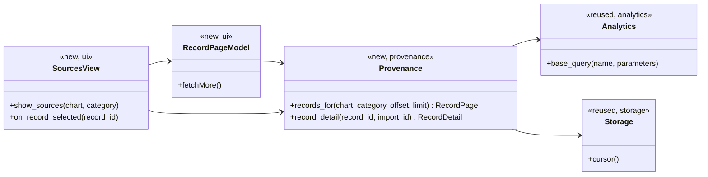
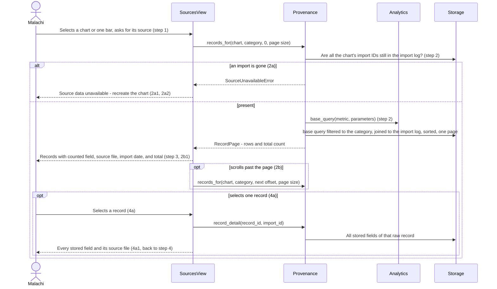

# Source Verification Design

**Project:** USPTO Patent Intelligence
**Team:** 06
**Area:** `UC-FEAT-*`, source verification (`FEAT-Verify-Source`). Every use case shares the area code `FEAT` ([use-cases.md](../requirements/use-cases.md) section 3), so the design documents are split by feature area, as [architecture 5.2](architectural-design.md#52-use-case-areas-and-components) does.

> **Realizes:** `UC-FEAT-verify-source`, and the drill-down of `UC-FEAT-create-visuals` extension 6a
> **Depends on:** `BR-evidence-based-analysis`, `BR-data-driven-insights`, `BR-no-data-alteration`; `SAF-evidence-required`, `DI-source-tracking`, `FR-CHART-counted-field`, `DI-identifiable-people`; `KD-charts-from-sql`, `KD-raw-and-staged`
> **See:** [use cases](../requirements/use-cases.md), [specification](../requirements/software-requirements-specification.md) (7.2, 7.4), [architecture-of-record](architectural-design.md) (5.2, 8.2, `QS-chart-traces-to-records`), [data intake design](intake.md), [visualization design](visualization.md)
> **Designed against:** `main` @ `b621e0b`. No application code exists yet. Built after the [intake](intake.md) and [visualization](visualization.md) areas, whose files it reuses.

> **Status: draft.** Written by an agent at the team's request, before any code and before the questions test.

---

## Overview

_[One paragraph: what this area does, which components of your [architecture-of-record](architectural-design.md) it lives in, and what it reads from or calls in other areas. Link the container diagram rather than redrawing it. If this design changes the architecture-of-record, say so here and list the change under "Changes to the architecture-of-record" below.]_

Source verification shows Malachi the records behind a chart or one bar of it, each with the weekly file it came from and its import date, and lets him open any one record in full. It is the **Provenance** component ([5.2](architectural-design.md#52-use-case-areas-and-components)) and the Sources view (`UI-main-views`). Provenance takes the chart's identity from [visualization](visualization.md) (metric, parameters, import IDs, counted field), asks Analytics for the metric's base query, filters it to the selected category, and joins the result to the import log the [intake design](intake.md) writes. It only reads. It does not change the architecture.

## Components & classes

_[One class diagram for the whole area, and one line per class or file saying what it does and whether it is **new** or **reused**. Show only what a reader needs to see how the parts relate: classes, their key methods, their dependencies. Fields and getters belong to the code._

_**If your repository has no code for this area yet**, which is the normal case for your proving slice, list the files you expect the agent to create, with the paths your architecture-of-record's conventions give them, and mark them all new. The agent then builds into the structure you chose rather than one it improvised.]_

- `provenance/service.py` (new): `records_for` and `record_detail`.
- `provenance/errors.py` (new): `SourceUnavailableError`.
- `ui/sources_view.py` (new): the records table, the total count, and the single-record panel.
- `ui/record_page_model.py` (new): a Qt table model that fetches one page at a time from `records_for` as Malachi scrolls (2b; `KD-ui-framework`).
- `analytics/service.py` (reused, [visualization](visualization.md)): `base_query`.
- `storage` (reused, [intake](intake.md)): read cursors only.

## Sequence

_[One sequence diagram per use case for its main success scenario, plus one for each extension that does not just return an error. **Label each interaction with the use case step it implements**, so a reviewer can check that every step is realized and nothing extra was invented. Use `alt` blocks for extensions that branch off the main flow. Give each use case its own `###` heading; that heading is the anchor your traceability matrix cites.]_

### UC-FEAT-verify-source: viewing the records behind a chart

`UC-FEAT-create-visuals` 6a enters at step 1 with the bar Malachi clicked.

## API contract

_[One row per endpoint, scheduled job, or message this area adds or changes, appended per use case. **This section is never dropped**: before the code exists it is the only thing the person (or agent session) building the front end and the one building the back end both read. Name the caller and who may call it, the request fields, the success response, and the error each extension returns. Leave field types and exact JSON to the agent unless a wrong guess would break something, such as a format another system depends on. Use the error shape your architecture-of-record's section 8.2 fixes; do not invent one here.]_

There is no network API ([8.2.3](architectural-design.md#82-other-concepts)). Errors are `AppError` subclasses ([8.2.1](architectural-design.md#82-other-concepts)).

| Function | Caller (who may) | Request | Success | Errors, by extension |
|---|---|---|---|---|
| `provenance.records_for` | The UI (Sources view, and the chart tabs for create-visuals 6a) | Chart identity, category (none means the whole chart), offset, page size | `RecordPage`: rows and the total count. Each row: record ID, application number, the chart's counted field, source file name, import date ([use case](../requirements/use-cases.md) "Source display strategy"). Sorted by source file, then record ID | 2a: `SourceUnavailableError`. 2b: not an error; more pages are fetched with a larger offset. |
| `provenance.record_detail` | The UI | Record ID, import ID | `RecordDetail`: every stored field of that raw record as stored, plus source file name and import date | Record not found: `SourceUnavailableError`. |

## Key decisions

_[Only the decisions a reader could not recover from the code: an invariant, who may do this and how it is enforced, a trade-off you chose, a reason you reused something rather than writing it. **Each one names what you chose, what you rejected, and why.** If you cannot name an alternative you considered, it probably was not a decision; leave it out._

_A decision that affects the whole system rather than this area is an architecture decision. It belongs in your architecture-of-record as a `KD-*` entry, not here.]_

**Provenance filters the metric's own base query.** The rows listed are, by construction, the rows the bar counted, so the total shown always equals the bar's value (`QS-chart-traces-to-records`). Rejected: a hand-written "find records for this chart" query per metric, which can disagree with the chart.

**A chart's source is unavailable if any of its imports is gone.** The chart records the import IDs it covered; if any is missing from the import log (the dataset was deleted, `DI-disposal`), Provenance refuses rather than listing fewer records than the bar shows. Rejected: listing whatever is left, which would show a count that silently disagrees with the chart Malachi is about to publish.

**The single-record view reads the raw record, not the staged row.** Malachi sees the values exactly as the USPTO supplied them, which is the evidence (`BR-no-data-alteration`, `KD-raw-and-staged`). Rejected: showing the staged row, which has been typed and renamed.

**Pages are fetched on demand.** The total is counted once, and rows are read a page at a time as the table scrolls. Rejected: loading every row, since one bar of a year's data can hold tens of thousands of office actions including their letter text.

## Data model

_[The **change** this area makes to the data: new tables or entities, new columns, the migration that adds them. Draw an ER diagram when there is more than one new table. Do not redraw the domain model; your [specification](../requirements/software-requirements-specification.md) owns it, so link it and show only the change. If the area changes nothing, say "No change" and give the reason in one line; that is a design decision too.]_

No change. Provenance reads the raw tables, the staged views, and the import log the [intake design](intake.md) creates.

## Reuse & cross-cutting

_[Which existing services, components, and conventions this area uses rather than rebuilding: authentication, the error handler, email, the clock, another area's service. Cite your architecture-of-record's section 8.2 for each convention by name rather than restating it.]_

Reuses Storage and `errors.AppError` ([intake](intake.md)) and `analytics.base_query` and the chart identity ([visualization](visualization.md)). Conventions from [architecture 8.2](architectural-design.md#82-other-concepts): error handling (8.2.1), time (8.2.2, import dates shown as YYYY-MM-DD), components (8.2.3), logging (8.2.7: the letter text and examiner number are shown on screen but never logged), auditing (8.2.9, the import log is the source file record), and testing (8.2.10).

## Tests

_[One row per flow: the main success scenario and **every** extension of every use case this document realizes, appended per use case. Name the level (unit or integration) and what the test asserts. No code. This list is the definition of done that the reviewer approves; the agent writes these tests when it builds, and a reviewer can see at a glance whether an extension has no test.]_

| Use case, flow | Level | Asserts |
|---|---|---|
| UC-FEAT-verify-source main | integration | For every metric and every bar of a fixture's charts, the total returned equals the bar's value, and every row names its source file and import date (`QS-chart-traces-to-records`) |
| UC-FEAT-verify-source main | unit | Rows are sorted by source file, then record ID |
| UC-FEAT-verify-source 2a | integration | After the import behind a chart is removed, `records_for` raises `SourceUnavailableError` and lists nothing |
| UC-FEAT-verify-source 2b | unit | With more rows than a page, the first page holds one page of rows, the total is the full count, and consecutive pages neither skip nor repeat a row |
| UC-FEAT-verify-source 4a | unit | `record_detail` returns every stored field, character for character as in the fixture, plus the source file |
| UC-FEAT-verify-source read only | integration | Viewing sources leaves every table's row count unchanged (POST-2) |
| UC-FEAT-verify-source counted field | unit | Each row shows the field the chart counted (`FR-CHART-counted-field`) |
| UC-FEAT-create-visuals 6a | integration | Clicking a bar opens the Sources view with that bar's records |

## Changes to the architecture-of-record

_[Designing an area against real code is when the architecture's guesses meet reality. If this design needs a component the map does not have, moves a responsibility, or adds a dependency, **change [the architecture-of-record](architectural-design.md) in the same pull request** and list each change here in one line. If nothing changed, write "None". A design that silently disagrees with the architecture leaves two maps, and the agent will follow whichever it reads last.]_

None.

## Open questions & risks

_[What this design could not settle and who can, and what could go wrong that you are accepting. A question for the client also goes in [`OPEN-ISSUES.md`](../requirements/OPEN-ISSUES.md).]_

- **2a needs a way to delete a dataset.** Deleting a dataset (`DI-disposal`) belongs to Settings and Data Management, and no use case describes it yet. Until one exists, 2a can be reached only in tests. Propose a use case for deleting a dataset.
- **Examiner numbers on screen.** The single-record view shows the examiner employee number because it is a stored field. Showing it to Malachi is not publishing it, but `OI-9` may change what he wants to see.
- **Copying records out.** The use case does not ask for copying or exporting the record list, so this design has none. If Malachi wants it for his paper trail, it is a new use case.
- **Risk accepted:** each page re-runs the filtered base query, so scrolling a very large bar is slower than a cached list. `PER-dashboard` covers charts, not this view.

---

## Working this document with your agent

_[Delegate: drafting the diagrams from your sketch and the use case; listing the existing files a class should extend; filling the contract rows' request and response fields; proposing the test row for each extension; drafting the rejected alternative for a decision you have already made; checking that every identifier this document cites exists in the document that owns it._

_Keep human: which side of the "would a wrong guess break something" line each detail falls on; every key decision; and the approval, which is a teammate's review of the pull request, not the drafter's own reading._

_**The specific failure to watch for: scope that nobody asked for.** An agent drafting a design adds what designs it has read usually have: an admin override, a retry queue, a status field, a notification "while we are here". Each looks reasonable and none is in your use case, and once it is in the design the agent will build it, test it, and you will maintain it. Read the sequence labels: every interaction should name the use case step it implements. An interaction with no step is either a missing requirement, which goes to your specification and your client, or scope creep, which comes out.]_

---

## The questions test (before you open the pull request)

_[Start a **fresh** agent session in plan mode, so it carries nothing from the session that drafted this document. Give it only the use case, the business rules it cites, your architecture-of-record's section 8, and this document, and ask:_

> _List every point you would still have to guess to implement `<UC-ID>`. For each, say what you would guess and whether a wrong guess could violate a requirement. Do not write code._

_For each item on its list, either fix this document or keep the guess and write one line saying why a wrong guess breaks no requirement. Paste the list, with your answer to each item, into the pull request description under How it was verified, inside a collapsed `

Questions test
 … 
` block so the description stays short. The design is ready when nothing on the list could break a requirement.]_

Not run yet.
