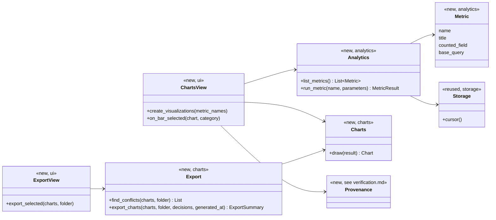
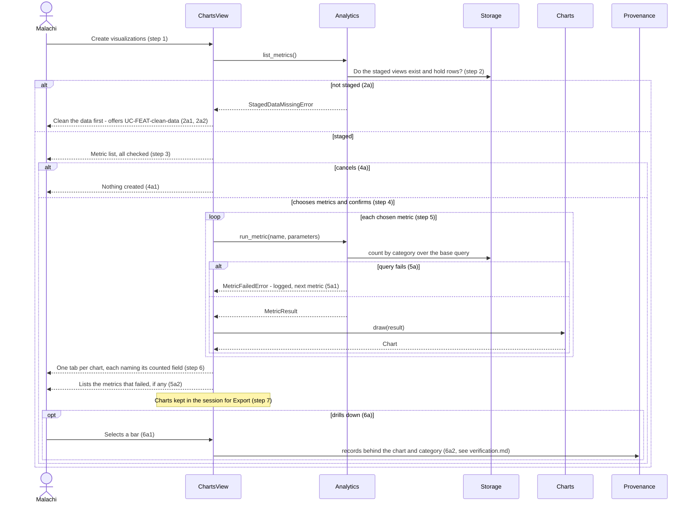
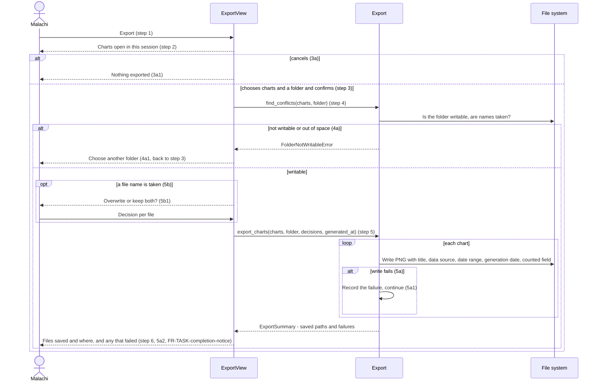

# Visualization Design

**Project:** USPTO Patent Intelligence
**Team:** 06
**Area:** `UC-FEAT-*`, visualization (`FEAT-Generate-Visualization`). Every use case shares the area code `FEAT` ([use-cases.md](../requirements/use-cases.md) section 3), so the design documents are split by feature area, as [architecture 5.2](architectural-design.md#52-use-case-areas-and-components) does.

> **Realizes:** `UC-FEAT-create-visuals`, `UC-FEAT-export-visuals`, `FR-CHART-counted-field`, `FR-TASK-completion-notice` (for export)
> **Depends on:** `BR-evidence-based-analysis`, `BR-data-driven-insights`, `BR-rejection-distribution-metric`, `BR-pendency-trend-metric`; `SAF-evidence-required`, `INT-export`, `PER-dashboard`, `UI-main-views`; `KD-ui-framework`, `KD-charts-from-sql`, `KD-raw-and-staged`
> **See:** [use cases](../requirements/use-cases.md), [specification](../requirements/software-requirements-specification.md) (5.2, 7.3, 9.7), [architecture-of-record](architectural-design.md) (5.2, 8.2), [data intake design](intake.md) (the staged views this area reads)
> **Designed against:** `main` @ `b621e0b`. No application code exists yet. This area builds on the files the [intake design](intake.md) creates, so it is implemented after the proving slice.

> **Status: draft.** Written by an agent at the team's request, before any code and before the questions test. The metric list depends on `OI-1`, `OI-3`, `OI-7`, and `OI-8`; see [Open questions & risks](#open-questions--risks).

---

## Overview

_[One paragraph: what this area does, which components of your [architecture-of-record](architectural-design.md) it lives in, and what it reads from or calls in other areas. Link the container diagram rather than redrawing it. If this design changes the architecture-of-record, say so here and list the change under "Changes to the architecture-of-record" below.]_

Visualization turns the staged dataset into charts, one tab per metric, and writes chosen charts to PNG files labeled for posting. It lives in two components ([5.2](architectural-design.md#52-use-case-areas-and-components)): **Analytics**, which owns each metric as a named SQL query over the staged views the [intake design](intake.md) builds, and **Charts and Export**, which draws metric results with matplotlib and saves them. The Desktop UI shows the charts as tabs and has an Export view (`UI-main-views`); how the chart tabs map onto the Weekly Overview, Art Units, and Trends views waits on wireframes (`OI-18`). Drilling into a chart (`UC-FEAT-create-visuals` 6a) is the same flow as `UC-FEAT-verify-source` and is designed in [verification.md](verification.md); this area only hands it the chart and the selected bar. Everything runs inside the Desktop Application container ([5.1](architectural-design.md#51-containers)). This design does not change the architecture.

## Components & classes

_[One class diagram for the whole area, and one line per class or file saying what it does and whether it is **new** or **reused**. Show only what a reader needs to see how the parts relate: classes, their key methods, their dependencies. Fields and getters belong to the code._

_**If your repository has no code for this area yet**, which is the normal case for your proving slice, list the files you expect the agent to create, with the paths your architecture-of-record's conventions give them, and mark them all new. The agent then builds into the structure you chose rather than one it improvised.]_

- `analytics/metrics.py` (new): the metric registry. Each `Metric` has a name, a title, the field it counts (`FR-CHART-counted-field`), its parameters, and a **base query** that returns one row per counted item with its record ID and its category.
- `analytics/service.py` (new): `list_metrics`, `run_metric`, `base_query`, and `technology_centers` (the choices for the Art Unit metric's parameter). Counts are `count(*)` grouped by category, and by category and series for a two-way metric, over the base query, run in DuckDB ([8.2.4](architectural-design.md#82-other-concepts)). Also returns the import IDs covered and the earliest and latest submission dates (the chart's date range).
- `analytics/errors.py` (new): `StagedDataMissingError`, `MetricFailedError`.
- `charts/draw.py` (new): turns a `MetricResult` into a `Chart`, which holds the matplotlib figure and the chart's identity (metric name, parameters, import IDs, counted field, date range). Every chart shows its counted field on screen.
- `charts/export.py` (new): `find_conflicts` and `export_charts`. Adds the label block (title, data source, date range, generation date, counted field) and writes PNG.
- `charts/errors.py` (new): `FolderNotWritableError`.
- `ui/charts_view.py` (new): the metric chooser (steps 3 and 4) and one tab per chart (step 6); a click on a bar calls Provenance.
- `ui/export_view.py` (new): the list of charts open in this session, the folder picker, and the overwrite-or-keep-both question (5b1).
- `storage` (reused from [intake.md](intake.md)): read cursors only; this area never writes to the database.

### Release 1.0 metrics (proposed, pending `OI-1`)

Each is one base query over the staged views. The names are the identifiers code and tests use.

| Metric | Counts | Category | Counted field (shown on the chart) | Report it serves ([SRS 7.3](../requirements/software-requirements-specification.md#73-reports)) |
|---|---|---|---|---|
| `office-actions-by-document-code` | Office actions | Document code (CTNF, CTFR, other codes as given) | Document code | Weekly USPTO Overview |
| `office-actions-by-technology-center` | Office actions | Technology Center | Technology Center | Weekly USPTO Overview |
| `rejections-by-type` | Rejection entries | USPTO rejection type (`101`, `102`, `103`, `112`, `DoublePatent`, `Other`, none given) | USPTO rejection tag | Rejection Distribution (`BR-rejection-distribution-metric`) |
| `office-actions-by-art-unit` | Office actions, for one Technology Center chosen as a parameter | Art Unit | Art Unit | Art Unit Activity |

**Two-way metrics** (added during the build at the developer's request, 2026-10-30, from the sample-file findings under [Open questions](#open-questions--risks); also pending `OI-1`). Each category is split by a second field, the **series**:

| Metric | Counts | Category | Series | Counted field (shown on the chart) | Report it serves |
|---|---|---|---|---|---|
| `rejections-by-technology-center-and-type` | Rejection entries | Technology Center | USPTO rejection type, none given included | USPTO rejection tag, by Technology Center | Rejection Distribution (`BR-rejection-distribution-metric`) |
| `office-actions-by-technology-center-and-document-code` | Office actions | Technology Center | Document code (the CTFR share is the final rejection share) | Document Code, by Technology Center | Weekly USPTO Overview |

Not designed until the client answers: a rejection count from the letter text (`OI-7`), and any pendency metric (`OI-8`, `BR-pendency-trend-metric`). Each is one more row in the registry when it is answered.

## Sequence

_[One sequence diagram per use case for its main success scenario, plus one for each extension that does not just return an error. **Label each interaction with the use case step it implements**, so a reviewer can check that every step is realized and nothing extra was invented. Use `alt` blocks for extensions that branch off the main flow. Give each use case its own `###` heading; that heading is the anchor your traceability matrix cites.]_

### UC-FEAT-create-visuals: creating visualizations

### UC-FEAT-export-visuals: exporting charts

A file that runs out of space part way through is a 5a failure for that chart; files already written stay (the use case's failure handling).

## API contract

_[One row per endpoint, scheduled job, or message this area adds or changes, appended per use case. **This section is never dropped**: before the code exists it is the only thing the person (or agent session) building the front end and the one building the back end both read. Name the caller and who may call it, the request fields, the success response, and the error each extension returns. Leave field types and exact JSON to the agent unless a wrong guess would break something, such as a format another system depends on. Use the error shape your architecture-of-record's section 8.2 fixes; do not invent one here.]_

There is no network API ([8.2.3](architectural-design.md#82-other-concepts)). Errors are `AppError` subclasses ([8.2.1](architectural-design.md#82-other-concepts)).

| Function | Caller (who may) | Request | Success | Errors, by extension |
|---|---|---|---|---|
| `analytics.list_metrics` | The UI | None | The metric registry: name, title, counted field, series field, parameters | 2a: `StagedDataMissingError` when the staged views are missing or empty. |
| `analytics.technology_centers` | The UI (the Art Unit metric's parameter) | None | The Technology Centers staged, in order | None. |
| `analytics.run_metric` | The UI, and Provenance (verification.md) | Metric name, parameter values | `MetricResult`: count per category, and for a two-way metric count per category and series (`breakdown`); counted field, import IDs covered, earliest and latest submission date | 5a: `MetricFailedError` naming the metric. |
| `analytics.base_query` | Provenance only | Metric name, parameter values | The base query and its parameters, so Provenance filters the same rows the chart counted (`KD-charts-from-sql`). Rows: record ID, category, series (two-way metrics only), import ID, submission date | Unknown metric or wrong parameters: `MetricFailedError`. |
| `charts.draw` | The UI | `MetricResult` | `Chart`: figure plus identity (metric, parameters, import IDs, counted field, date range), and each bar or segment with the category and series it shows | Drawing failure is a 5a failure for that metric. |
| `charts.find_conflicts` | The Export view | Charts, folder | The file names that already exist | 4a: `FolderNotWritableError`. |
| `charts.export_charts` | The Export view | Charts, folder, overwrite or keep-both decision per conflict, generation date (passed in, [8.2.2](architectural-design.md#82-other-concepts)) | `ExportSummary`: path of each saved file, and each chart that failed with its reason | 4a: `FolderNotWritableError`. 5a: per chart, in the summary, not raised. |

## Key decisions

_[Only the decisions a reader could not recover from the code: an invariant, who may do this and how it is enforced, a trade-off you chose, a reason you reused something rather than writing it. **Each one names what you chose, what you rejected, and why.** If you cannot name an alternative you considered, it probably was not a decision; leave it out._

_A decision that affects the whole system rather than this area is an architecture decision. It belongs in your architecture-of-record as a `KD-*` entry, not here.]_

**Every metric is a base query, and the count is derived from it.** A metric defines only the rows it counts (record ID and category). Analytics counts them, and Provenance lists them, from the same text. Rejected: a separate counting query and listing query per metric, which can drift apart and break `QS-chart-traces-to-records` without any test noticing.

**Rejection metrics count rejection entries; office action metrics count office actions.** They read different staged views, and the chart's label says which. Rejected: counting office actions in a rejection chart, which hides an office action with several rejections. The sample has exactly one entry per record, so the two agree today, but the letter text can cite more (`RI-Inconsistent-Source-Fields`).

**Rejection entries with no type are shown, not dropped.** They are their own bar, labeled as having no type in the source. Rejected: leaving them out, which makes the bars add up to less than the office actions and changes a figure without saying so (`BR-no-data-alteration`).

**"Staged for export" means kept in the session.** Charts created in this session are held in memory, and the Export view lists them. Rejected: saving charts in the database, which adds a table and a lifecycle nobody asked for. Architecture section 7 already says charts on screen are lost on restart and recomputed.

**The label is drawn into the image.** Title, data source (the USPTO weekly office action file names), date range, generation date, and counted field are drawn below the chart, so the label survives being copied into a post. Rejected: file metadata, which LinkedIn and Instagram strip.

**A two-way metric is the same base query with a series column, drawn as 100% stacked bars.** Each Technology Center is one horizontal bar split into the shares of its series, with its total (n) beside its name; a segment shows its share where it fits, and selecting one drills down to that category and series. Rejected: stacking counts, where Technology Center 3900 (19 office actions in the sample) vanishes beside 3700 (1,402); grouped bars, which give 70 bars for 10 Technology Centers and 7 types; and a separate cross-tab query, which breaks the base-query decision above. Shares are computed from the counts on screen, not stored.

**A series keeps its color from week to week.** Each two-way metric lists its known series values in a fixed order, and colors follow that order; a value not listed comes after them, and a value the source did not give is gray. Rejected: coloring by rank, which repaints a type when another type's count overtakes it.

**One image size.** PNG, sized for a LinkedIn post (`INT-export`). The exact pixel size is not specified anywhere; see Open questions.

## Data model

_[The **change** this area makes to the data: new tables or entities, new columns, the migration that adds them. Draw an ER diagram when there is more than one new table. Do not redraw the domain model; your [specification](../requirements/software-requirements-specification.md) owns it, so link it and show only the change. If the area changes nothing, say "No change" and give the reason in one line; that is a design decision too.]_

No change. Charts are computed from the staged views on demand and kept only in memory for the session (architecture section 7).

## Reuse & cross-cutting

_[Which existing services, components, and conventions this area uses rather than rebuilding: authentication, the error handler, email, the clock, another area's service. Cite your architecture-of-record's section 8.2 for each convention by name rather than restating it.]_

Reuses from the [intake design](intake.md): Storage's read cursor, `errors.AppError`, the main window, and the staged views. Calls Provenance ([verification.md](verification.md)) for 6a. Conventions from [architecture 8.2](architectural-design.md#82-other-concepts): error handling (8.2.1, a failed metric is shown, not raised to the top), time (8.2.2, the generation date is passed in and dates are shown as YYYY-MM-DD), components (8.2.3), code (8.2.4, counting in SQL), logging (8.2.7, metric names and counts only), and testing (8.2.10).

## Tests

_[One row per flow: the main success scenario and **every** extension of every use case this document realizes, appended per use case. Name the level (unit or integration) and what the test asserts. No code. This list is the definition of done that the reviewer approves; the agent writes these tests when it builds, and a reviewer can see at a glance whether an extension has no test.]_

| Use case, flow | Level | Asserts |
|---|---|---|
| UC-FEAT-create-visuals main | integration | After importing a fixture with known counts, each metric's counts equal the counts computed by hand for that fixture, and each chart names its counted field (`FR-CHART-counted-field`) |
| UC-FEAT-create-visuals main | unit | For every metric, the sum of its counts equals the number of rows its base query returns |
| UC-FEAT-create-visuals 2a | unit | With no staged views, `list_metrics` raises `StagedDataMissingError` and the UI offers cleaning |
| UC-FEAT-create-visuals 4a | unit (UI) | Cancelling the chooser creates no tabs and runs no query |
| UC-FEAT-create-visuals 5a | unit | When one metric's query fails, the others are drawn, the failure is logged by metric name, and the failed metric is listed to the user |
| UC-FEAT-create-visuals 6a | integration | Selecting a bar calls Provenance with the chart and category, and the records returned equal the bar's value (`QS-chart-traces-to-records`) |
| UC-FEAT-create-visuals two-way | integration | Each two-way metric's count per category and series equals the counts computed by hand for the fixture; the breakdown sums to the base query's rows, each category's shares sum to 100, and filtering the base query to one category and series returns that segment's count |
| UC-FEAT-create-visuals two-way colors | unit | A series keeps its color when the counts change order, and a missing series is gray |
| UC-FEAT-create-visuals no type | unit | A rejection entry with no type is its own bar, and the bars sum to the rejection entries staged |
| UC-FEAT-create-visuals step 7 | unit (UI) | Every chart created in the session is listed in the Export view |
| UC-FEAT-export-visuals main | integration | Exporting two charts to a temporary folder writes two PNG files, and each image's label contains the title, data source, date range, generation date (the value passed in), and counted field |
| UC-FEAT-export-visuals 3a | unit (UI) | Cancelling writes no files |
| UC-FEAT-export-visuals 4a | unit | A read-only folder raises `FolderNotWritableError` and no file is written |
| UC-FEAT-export-visuals 5a | unit | When one chart fails to write, the others are written, the failed one is listed, and the files already written remain |
| UC-FEAT-export-visuals 5b | unit | An existing file is replaced when the decision is overwrite, and kept with the new file saved under a different name when the decision is keep both |
| UC-FEAT-export-visuals notice | unit (UI) | The notice lists each saved path and each failure (`FR-TASK-completion-notice`) |
| No data altered | integration | Creating and exporting charts leaves the raw and staged row counts unchanged |

## Changes to the architecture-of-record

_[Designing an area against real code is when the architecture's guesses meet reality. If this design needs a component the map does not have, moves a responsibility, or adds a dependency, **change [the architecture-of-record](architectural-design.md) in the same pull request** and list each change here in one line. If nothing changed, write "None". A design that silently disagrees with the architecture leaves two maps, and the agent will follow whichever it reads last.]_

None.

## Open questions & risks

_[What this design could not settle and who can, and what could go wrong that you are accepting. A question for the client also goes in [`OPEN-ISSUES.md`](../requirements/OPEN-ISSUES.md).]_

- **Which metrics (`OI-1`).** The four metrics above are proposed from the reports in SRS 7.3 and the fields the sample fills. The client may want others.
- **Does Malachi choose metrics, or get all of them (`OI-3`).** This design follows the use case: a chooser with all metrics checked by default.
- **Rejection tag or letter text (`OI-7`).** `rejections-by-type` counts the tag and says so. A letter-text metric needs the client to define what text counts as citing a section.
- **Pendency (`OI-8`).** Not designed until the formula is chosen.
- **Export formats (`OI-2`).** PNG only, per `INT-export`.
- **Image size.** `INT-export` says "sized for LinkedIn posts" without a size. Propose 1200 × 1200 pixels at 2× scale, and ask the client which post shape he uses. This is a specification gap: the size belongs in `INT-export`.
- **Keep-both naming.** Propose adding ` (2)`, ` (3)`, and so on before the extension, as macOS Finder does.
- **Art units per chart.** One Technology Center has dozens of art units, and the whole office has 524; a chart of all of them is unreadable. This design takes the Technology Center as a parameter. Whether the client wants a "top N" chart instead is a client question, and N would be a threshold the team must not invent.
- **Examiner-level metrics** are not designed (`OI-9`).
- **What the sample shows (2026-10-18 file, 8,667 office actions, checked by hand during the build).** Candidates for the client under `OI-1`; only the two two-way metrics above are built.
  - Rejection type differs sharply by Technology Center: §101 is 12% of 3600's tagged rejections and under 1% of 1700's; double patenting is 25% of 1600's. Within 3600, some Art Units are 40–56% §101. Ranking Art Units by a share needs a minimum number of office actions per Art Unit, a threshold the client must set.
  - The final rejection (CTFR) share ranges from 33% (2800) to 46% (1600). Technology Centers 2900 and 3900 have about 20 office actions each, so their shares swing on a few records; the chart shows n for that reason.
  - Every record has exactly one tagged rejection entry, which supports `OI-7`'s concern that the tag undercounts.
  - Time from filing to this office action has a median of 1.8 years (3600) to 2.8 years (1600). This is close to pendency; it waits on `OI-8`.
  - One-way candidates that fit the current shape: filing year of the applications acted on (mostly 2023–2025), and office actions by Work Group within a Technology Center.
  - Application type, AIA indicator, and subject matter barely vary (99.7% regular utility applications) and make poor charts.
- **Risk accepted:** charts are not saved, so after a restart Malachi must create them again before exporting (a few seconds, `PER-dashboard`).

---

## Working this document with your agent

_[Delegate: drafting the diagrams from your sketch and the use case; listing the existing files a class should extend; filling the contract rows' request and response fields; proposing the test row for each extension; drafting the rejected alternative for a decision you have already made; checking that every identifier this document cites exists in the document that owns it._

_Keep human: which side of the "would a wrong guess break something" line each detail falls on; every key decision; and the approval, which is a teammate's review of the pull request, not the drafter's own reading._

_**The specific failure to watch for: scope that nobody asked for.** An agent drafting a design adds what designs it has read usually have: an admin override, a retry queue, a status field, a notification "while we are here". Each looks reasonable and none is in your use case, and once it is in the design the agent will build it, test it, and you will maintain it. Read the sequence labels: every interaction should name the use case step it implements. An interaction with no step is either a missing requirement, which goes to your specification and your client, or scope creep, which comes out.]_

---

## The questions test (before you open the pull request)

_[Start a **fresh** agent session in plan mode, so it carries nothing from the session that drafted this document. Give it only the use case, the business rules it cites, your architecture-of-record's section 8, and this document, and ask:_

> _List every point you would still have to guess to implement `<UC-ID>`. For each, say what you would guess and whether a wrong guess could violate a requirement. Do not write code._

_For each item on its list, either fix this document or keep the guess and write one line saying why a wrong guess breaks no requirement. Paste the list, with your answer to each item, into the pull request description under How it was verified, inside a collapsed `

Questions test
 … 
` block so the description stays short. The design is ready when nothing on the list could break a requirement.]_

Not run yet.
