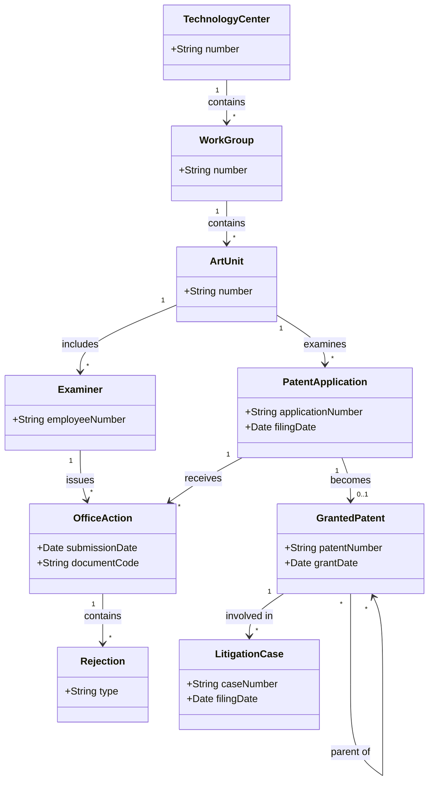

# Software Requirements Specification

**Project:** USPTO Patent Intelligence
**Team:** 6
**Client:** Malachi Hernandez (personal project)
**Version:** 1.3

---

_**How to use this template.** Instructions appear in italic square brackets. Fill in underneath them and leave them in place until the document is stable._

_**What this document is, and what it is not.** The specification describes the external behavior of your system completely enough that a developer can build it and a tester can check it. What it is **not** is a container for everything you have written. Your glossary, vision and scope, use cases, and business rules are separate documents with their own identifiers, and this one **links to them rather than repeating them**._

_That makes the specification mostly a hub. Read that as a feature. One fact, one home: a business rule copied in here is a business rule that will disagree with `business-rules.md` by October, and nobody will notice which copy is right. The sections below that say "link to" are supposed to be short._

_What this document owns outright: the requirements that have no other home. Functional requirements that are not part of any use case, quality attributes, external interfaces, data requirements, operating environment, and constraints._

## Identifiers

_Every requirement in this document carries a name-based slug. Create only the spaces your project actually needs._

| Space | For | Example |
|---|---|---|
| `FR-<AREA>-<slug>` | Functional requirements outside any use case | `FR-SAVE-autosave-active` |
| `UI-<slug>` | User interface requirements | `UI-spa-views` |
| `SI-<slug>` | Software and system interfaces | `SI-llm-proxy-only` |
| `CI-<slug>` | Communications interfaces | `CI-email-notifications` |
| `DI-<slug>` | Data requirements | `DI-persist-graph` |
| `OE-<slug>` | Operating environment | `OE-supported-browsers` |
| `CO-<slug>` | Design and implementation constraints | `CO-single-application` |
| `AS-<slug>` / `DE-<slug>` | Assumptions and dependencies | `AS-supported-browser`, `DE-llm-service` |

_Quality attributes get one space per attribute, so the identifier says which kind of quality it is at the place it is cited: `USE-` usability, `PER-` performance, `SEC-` security, `SAF-` safety, `AVL-` availability, `ROB-` robustness, `SCA-` scalability, `INT-` interoperability, `MNT-` maintainability._

_Requirements cited from elsewhere keep their own identifiers: `UC-*` from [use-cases.md](use-cases.md), `BR-*` from [business-rules.md](business-rules.md), `BO-*`, `SM-*`, `FEAT-*` from [vision-and-scope.md](vision-and-scope.md)._

## Revision History

| Date | Version | Description | Author |
|---|---|---|---|
| 2026-09-24 | 1.1 | Initial draft | Edwin Rodriguez |
| 2026-10-06 | 1.2 | Added sections | Edwin Rodriguez |
| 2026-10-28 | 1.3 | Filled section 5.2; data model and dictionary from the 2026-10-18 sample file; aligned with the architecture-of-record (macOS only, AI deferred); TBDs linked to `OI-*` | Cody Pinkston |

---

## 1. Introduction

### 1.1 The purpose of USPTO Patent Intelligence

_[What the system is for: who wants it, why, and who will use it. Even though the vision and scope answers this, restate it in a paragraph here, because people read this document without having read that one.]_

USPTO Office Action data is public but hard to analyze. It comes as large weekly bulk files, published raw and uncleaned. USPTO Patent Intelligence is a desktop application for macOS that takes this data, processes it entirely on the user's computer, and turns it into charts and overviews whose every figure can be traced back to the records it came from. It is built for one user, Malachi Hernandez, who publishes data-backed posts about how the USPTO's examination is performing and needs to produce them in far less than the 8 hours each one takes by hand. All processing runs locally, and no data is sent to the cloud. Release 1.0 has no AI features and no anomaly detection; those are later releases (vision and scope 4.3).

### 1.2 The purpose of this document

_[What this specification covers and for which release.]_

_Example: "This document describes the functional and nonfunctional requirements for release 1.0 of the Cafeteria Ordering System. It serves as the reference for the project's requirements, defining the scope, functionality, and constraints for stakeholders, developers, and testers."]_

This document describes the functional and nonfunctional requirements for release 1.0 of USPTO Patent Intelligence. It is the reference for the project's scope, features, and constraints for the client, developers, and testers.

### 1.3 Document conventions

_[Any typographical conventions, and the identifier formats above, so that someone adding a requirement later knows how to name it.]_

- Requirements use the identifier formats in the Identifiers table.
- Functional requirements are written in EARS format. "Shall" means the requirement is mandatory.
- Business rules, objectives, metrics, and features are cited by their identifiers.
- Items marked **TBD** are not yet confirmed and are tracked in [OPEN-ISSUES.md](OPEN-ISSUES.md).

### 1.4 References

_[Every document this specification refers to, with a link. At minimum, the four other documents in this folder. Include external standards you must conform to.]_

- _[Project glossary](project-glossary.md)_
- _[Vision and scope](vision-and-scope.md)_
- _[Use cases](use-cases.md)_
- _[Business rules](business-rules.md)_
- _[Open issues](OPEN-ISSUES.md)_
- _[The Easy Approach to Requirements Syntax (EARS)](https://alistairmavin.com/ears/)_
- Client project brief: *Local Patent Intelligence & USPTO Operations Analytics*
- Client interview notes, meeting #1, 2026-09-17
- USPTO Open Data Portal: https://data.uspto.gov

---

## 2. Overall Description

### 2.1 Product perspective

_[How this system relates to other systems and to the user's environment. Self-contained, or one component of something larger? Link to the product perspective section of your vision and scope and to your architecture's context diagram rather than redrawing them.]_

USPTO Patent Intelligence is a new, self-contained desktop application. It is not part of any USPTO system or any of the client's companies. Data flows in one direction: from USPTO bulk files, into the application.

Internally, the application has separate layers for data intake, storage, analytics, and visualization/export, all running on the client's computer. A local AI layer is planned for a later release.

See the product perspective in [vision-and-scope.md](vision-and-scope.md) section 4.1 and the context diagram in section 3 of the [architecture-of-record](../design/architectural-design.md#3-context-and-scope).

### 2.2 User classes and characteristics

_[The kinds of user, and what distinguishes them: frequency of use, technical skill, privilege level, whether they are inside or outside the client's organization. Link to the stakeholder profiles in your vision and scope; what belongs here is what affects the software's behavior, especially permissions.]_

- **Malachi (only user):** Uses the application about once a week to process the latest USPTO release and create content for posts. Understands patents and computer systems, but does not write code. He also maintains the application after the team graduates. Because he is the only user on his own computer, the application has no login, roles, or permission levels.
- **Post readers (not users):** Malachi's audience, including readers at the USPTO, in Congress, and at the US Department of State, sees only the exported charts and text. They never use the application, so every export must be clear, labeled, and backed by data on its own.

See the stakeholder profiles in [vision-and-scope.md](vision-and-scope.md) section 3.1.

### 2.3 Operating environment

_[The environment the software runs in: hardware, operating systems and versions, browsers, where users and servers are located, and any other software it has to coexist with.]_

_Examples:_

- _`OE-supported-browsers`: The system shall operate correctly on the current and previous major versions of Chrome, Firefox, Safari, and Edge._
- _`OE-server-platform`: The system shall run on a server running the current corporate-approved version of Linux._
- _`OE-access-paths`: The system shall permit access from the corporate intranet, from a VPN connection, and from Android and iOS phones and tablets._

- OE-desktop-os: The application shall run on macOS on Apple silicon. Minimum macOS version: TBD (`OI-17`). Windows is out of scope for release 1.0 (vision and scope 4.3), but only cross-platform libraries are used so it remains possible later (architecture `TD-macos-only`).
- OE-minimum-hardware: The application shall run on a computer with at least 16 GB of RAM and 50 GB of free storage. A GPU is optional (TBD, `OI-17`).
- OE-hardware-adaptive: When it starts, the application shall detect the available CPU, RAM, and storage, and adjust its processing to match. Adjusting the AI model choice is deferred with the AI features (architecture `KD-no-ai-in-mvp`).
- OE-offline-operation: Once data is loaded, the application shall do all processing, analysis, and AI work without an internet connection.
- OE-no-manual-dependencies: The application shall bundle or automatically start everything it needs (database, runtimes, AI models), so the user never installs or configures them manually.
- OE-client-machine: The client's computer is a 2022 MacBook Air with 24 GB of memory, a 2 TB SSD, and no discrete GPU. All performance measurements are taken on this machine.

### 2.4 Design and implementation constraints

_[Anything that limits the developers' options: corporate or regulatory policy, hardware limits, required languages or databases, coding standards, interfaces to other applications.]_

_Examples:_

- _`CO-database-engine`: The system shall use the corporate standard database engine._
- _`CO-language-version`: The backend shall be written in Java 21._
- _`CO-coding-standard`: Design, code, and maintenance documentation shall conform to the client's development standard._

_The constraint students forget: **who maintains this after you graduate, and what do they already know how to run?** If the answer is one person who knows Python, a Spring Boot service is a constraint violation nobody wrote down._

- CO-local-execution: The application shall not use cloud AI services or send user data off the computer.
- CO-open-weight-models: AI features shall use locally run open-weight models, such as Llama-family models. *Deferred:* applies when AI features are added (`KD-no-ai-in-mvp`).
- CO-swappable-models: It shall be possible to replace or upgrade the AI model without changing code. *Deferred:* applies when AI features are added (`KD-no-ai-in-mvp`).
- CO-layer-separation: The data processing, analytics, AI, and user interface shall be separate layers that can each be tested independently.
- CO-technology-evaluation: The technologies suggested in the brief are not mandatory. The team shall document its technology choice for each layer.
- CO-model-licensing: All bundled models and runtimes shall have licenses that allow the client's intended use (TBD). *Deferred:* applies when AI features are added (`KD-no-ai-in-mvp`).
- CO-no-paid-ai-services: The application shall not use OpenAI, Anthropic, or any other paid or cloud AI service.
- CO-zero-recurring-cost: The application shall have no hosting, subscription, or API costs.
- CO-single-maintainer: The client maintains the application after the team graduates and does not write code. The technology stack shall be kept simple, and routine tasks (updating data, changing the AI model) shall not require coding.
- CO-bulk-data-first: The application shall be designed around the USPTO bulk data files, which the client prefers. Use of the USPTO API is optional.

### 2.5 Assumptions and dependencies

_[An assumption is a factor you believe true without proof, which would change these requirements if it turned out false. A dependency is something outside your control that the project relies on: an external API, a third-party library, a change someone else has to make.]_

_Examples:_

- _`AS-supported-browser`: Users access the system with a browser that supports the ECMAScript version the frontend targets._
- _`DE-payroll-integration`: Operation depends on changes being made in the Payroll System to accept payment requests for meals ordered through this system._

---
- AS-office-action-format: The format of USPTO Office Action files stays stable during the project.
- AS-user-hardware: Users' computers meet the minimum hardware requirement.
- DE-uspto-bulk-data: The project depends on the USPTO continuing to publish Office Action data as weekly ZIP files and bulk downloads.
- DE-uspto-api: API access depends on the USPTO Open Data Portal, which requires a USPTO.gov account and an API key. Which API currently provides Office Action data is TBD. *Deferred:* the API is not used in release 1.0 (`CO-bulk-data-first`).
- DE-local-llm-runtime: AI features depend on a third-party local AI runtime and third-party model files. *Deferred:* no AI in release 1.0 (`KD-no-ai-in-mvp`).
- AS-weekly-cadence: The client processes one USPTO release per week (`BR-weekly-office-action-data`).
- AS-speed-not-critical: Processing does not need to be fast. The client said it can run unattended, as long as it is low cost.
- AS-release-scope: Whether grant and litigation data are included in release 1.0, or only office action data, is TBD (`OI-10`). Vision and scope 4.3 currently puts them out of scope.
- DE-client-sample-data: Requirements in sections 7 and 8 depend on sample data from the client. One weekly office action file (`bdr_oa_bulkdata_weekly_2026-10-18.json`) has been received and is the basis of sections 7.1 and 7.2. Further weekly files (`OI-14`) and the client's process video (`OI-15`) are still outstanding, and no grant or litigation sample has been received.
- DE-uspto-grant-data: Grant analysis depends on USPTO patent grant datasets (`BR-separate-dataset-domains`).
- DE-litigation-data: Litigation analysis depends on the availability of patent litigation datasets (`BR-separate-dataset-domains`).
- DE-uspto-api-outages: The client reports that the USPTO API sometimes drops out for about 2 minutes.

## 3. Project Glossary

_[Link only. The glossary is [project-glossary.md](project-glossary.md).]_

See [project-glossary.md](project-glossary.md).

## 4. Vision and Scope

_[Link only. Business requirements, objectives, metrics, and scope live in [vision-and-scope.md](vision-and-scope.md).]_

See [vision-and-scope.md](vision-and-scope.md).
---

## 5. Functional Requirements

### 5.1 Use cases

_[Link to [use-cases.md](use-cases.md). Most of your system's behavior is specified there, as use cases, and it does not get restated here.]_

See [use-cases.md](use-cases.md).

### 5.2 Non-use-case functional requirements

_[Behavior that is real, testable, and belongs to no single use case: autosave, validation applied everywhere, notification, authorization, audit logging. If you find yourself writing the same step into six use cases, it belongs here instead._

_Group them under sub-headings by concern, and write each one using an [EARS](https://alistairmavin.com/ears/) shape so that it cannot be read two ways:_

- _**Ubiquitous:** The `<system>` shall `<response>`._
- _**Event driven:** When `<trigger>`, the `<system>` shall `<response>`._
- _**State driven:** While `<in a state>`, the `<system>` shall `<response>`._
- _**Optional:** Where `<feature is included>`, the `<system>` shall `<response>`._
- _**Unwanted behavior:** If `<precondition>`, then the `<system>` shall `<response>`._

_Example: `FR-SAVE-autosave-active`: While a student is editing a weekly activity report during an active week, the system shall persist the draft every 30 seconds._

_**Every requirement here needs an oracle.** If you cannot say how a tester would tell whether it holds, it is not a requirement yet.]_

#### Long-running tasks

- `FR-TASK-completion-notice`: When an import, a cleaning run, or an export finishes or fails, the system shall show a notice inside the application stating the outcome; for an import, the notice shall state the number of records loaded and the number rejected.
  *Oracle:* Run each task once to success and once to failure. Each run produces an in-app notice naming the outcome, and for an import, loaded plus rejected equals the number of records in the file (`SM-Complete-Intake` in vision and scope).
  *Applies to:* `UC-FEAT-decompile-files` steps 7 and 5a2, `UC-FEAT-clean-data` steps 4 and 2a2, `UC-FEAT-export-visuals` step 6. Notices stay inside the application (`CI-in-app-notifications`, `CI-no-external-messages`).

#### Charts

- `FR-CHART-counted-field`: The system shall label every chart, on screen and in every export, with the data field its figures were counted from, for example the USPTO rejection tag or the rejection text in the office action letter.
  *Oracle:* For every chart type, the on-screen chart and its exported image both name the field; opening the chart's source records (`UC-FEAT-verify-source`) shows that same field.
  *Applies to:* `UC-FEAT-create-visuals`, `UC-FEAT-export-visuals`, `UC-FEAT-verify-source`. Grounded in `BR-evidence-based-analysis` and `RI-Inconsistent-Source-Fields` (vision and scope 2.6). Which field each metric uses by default is open (`OI-7`).

#### AI verification (deferred)

- `FR-VERIFY-ai-claims`: Where the AI assistant is included, the system shall check that every number and record reference in an AI answer appears in the records the answer cites, and shall not let an answer that fails the check be exported as verified.
  *Oracle:* An answer containing a number not present in its cited records is flagged and cannot be exported as verified; an answer whose figures all appear in its cited records can be.
  *Applies to:* `UC-FEAT-query-ai` steps 6 and 4a; `SAF-ai-grounding`. *Deferred:* no AI in release 1.0 (`KD-no-ai-in-mvp`).

---

## 6. Business Rules

_[Link only, to [business-rules.md](business-rules.md). Business rules are a rich source of requirements because they dictate properties the system must have in order to conform to them, but the rules themselves are properties of the client's business, not of your software, and they have their own document.]_

See [business-rules.md](business-rules.md).

---

## 7. Data Requirements

### 7.1 Business domain model

_[The entities in the problem domain and how they relate, as a mermaid class diagram. Model the **business**, not your database schema: this is what the client would recognize, before any decision about tables or persistence.]_

Based on the client interview, the business rules, and the 2026-10-18 sample weekly file. Granted patents and litigation cases are drawn from the business rules only; no grant or litigation sample has been received (`DE-client-sample-data`).

### 7.2 Data dictionary

_[Each entity's fields, with data type, allowed values, defaults, and validation rules. Where a use case already specifies a field's validation in its Associated Information, cite the use case instead of repeating it.]_

Office action fields come from the 2026-10-18 sample weekly file: 8,667 records, one JSON object per line. The **source field** column gives the field name in that file. The **filled** column counts the sample records with a non-empty value, so a reader can see which fields charts can rely on. Fields are stored unchanged in the raw records (`BR-no-data-alteration`); the rules below are what Ingestion checks (architecture 8.2.5). Other weeks may differ (`OI-14`).

| Entity | Field | Source field | Type | Filled (of 8,667) | Rules |
|---|---|---|---|---|---|
| Office Action | record ID | `id` | Text | 8,667 | Required, unique; the key provenance uses |
| Office Action | document code | `documentCode` | Text | 8,667 | Required. Values seen: `CTNF` (non-final, 5,160), `CTFR` (final, 3,507); other codes are kept and reported, not rejected |
| Office Action | submission date | `submissionDate` | Timestamp (UTC) | 8,667 | Required; the date the office action was submitted, used to place it in a week |
| Office Action | letter text | `oaText` | Text | 8,667 | Required; stored in full (architecture `KD-raw-and-staged`); never logged |
| Office Action | examiner | `examinerEmployeeNumber` | Text | 8,667 | Required; identifies a real person (`DI-identifiable-people`) |
| Office Action | art unit | `groupArtUnitNumber` | Integer, 4 digits | 8,667 | Required (`BR-art-unit-assignment`) |
| Office Action | work group | `workGroup` | Text, 4 digits | 8,667 | Required; usually the first three digits of the art unit followed by 0, but 22 sample records differ, so it is stored as given and never derived from the art unit |
| Office Action | Technology Center | `techCenter` | Text, 4 digits | 8,667 | Required; equals the first two digits of the art unit followed by 00 |
| Rejection | type | `rejections[].type` | Text | 8,644 | Values seen: `101`, `102`, `103`, `112`, `DoublePatent`, `Other` (`BR-102-rejection`, `BR-103-rejection`, `BR-112-rejection`, `BR-double-patenting`); 23 records have a rejection with no type. Every sample record has exactly one rejection entry, although its letter text may cite more (`RI-Inconsistent-Source-Fields`, `OI-7`) |
| Rejection | label | `rejections[].label` | Text | 8,667 | Finer detail such as `112(b)` |
| Patent Application | application number | `patentApplicationNumber` | Text | 8,667 | Required; not unique per office action, because one application can receive several |
| Patent Application | filing date | `filingDate` | Timestamp (UTC) | 8,667 | Required; on or before the submission date |
| Patent Application | effective filing date | `effectiveFilingDate` | Timestamp (UTC) | 8,667 | Required |
| Patent Application | application type | `applicationTypeCategory` | Text | 8,667 | Values seen: `REGULAR` (8,658), `REISSUE` (9) |
| Patent Application | subject matter | `inventionSubjectMatterCategory` | Text | 8,667 | Values seen: `UTL` utility (8,645), `DES` design (22) |
| Patent Application | title | `inventionTitle` | Text | 8,665 | Optional |
| Patent Application | national class and subclass | `nationalClass`, `nationalSubClass` | Text | 2,701 / 2,697 | Optional; mostly empty, so not suitable for charts without a stated caveat |
| Import (provenance) | source file, import ID, import time | (added by the application) | Text, Timestamp | All | Required on every raw record (`DI-source-tracking`) |
| Granted Patent | patent number, grant date | Not in the office action file | Text, Date | — | TBD: no grant sample received (`DE-uspto-grant-data`, `OI-10`) |
| Litigation Case | case number, filing date | Not in the office action file | Text, Date | — | TBD: no litigation sample received (`DE-litigation-data`, `OI-10`) |

The file's remaining fields (`accessLevelCategory`, `aiaindicator`, `applicationDeemedWithdrawnDate`, `applicationStatusNumber`, `cmsIdentifier`, `cmsLastModifiedTimeStamp`, `customerNumber`, `documentActiveIndicator`, `obsoleteDocumentIdentifier`, `patentApplicationConfirmationNumber`, `sections`, `sourceSystemName`, `systemCreateTimestamp`, `systemLastModifiedTimestamp`) are kept in the raw records but are not used by any release 1.0 chart.

**Pendency** (`BR-pendency-trend-metric`): the formula is open, specifically whether the client wants first-action or total pendency (`OI-8`; see the glossary entry for Pendency).

### 7.3 Reports

_[Any report the system generates: who reads it, what it contains, how often, and in what format. Reports are where clients discover late that a field they need was never captured, so specify them early.]_

The client reads every report; his post readers see the exported charts. Every report shows its title, data source, date range, and generation date (`BO-Post-Visuals`).

| Report | Frequency | Contents |
|---|---|---|
| Weekly USPTO Overview | Weekly (primary report) | How the USPTO performed in the latest weekly release: volumes, action types, and rejection mix |
| Rejection Distribution | Weekly or on demand | Office actions by rejection type, by Art Unit and time period (`BR-rejection-distribution-metric`) |
| Pendency Trend | On demand | Pendency over time, by Art Unit and Technology Center (`BR-pendency-trend-metric`) |
| Art Unit Activity | On demand | Office action volume and trends per Art Unit |
| Patent History | On demand | One patent's application, office actions, grant, family, and litigation in a single timeline (`BR-cross-record-linkage`) |
| Monthly / Yearly Overview | Future (client: nice to have, not needed now) | Same as the weekly overview over a longer period |

### 7.4 Data acquisition, integrity, retention, and disposal

_[Where the data comes from, how it is kept correct, how long it is kept, and how it is destroyed. If your system holds anything about students or other identifiable people, this section is not optional, and its content is usually a business rule you should cite rather than invent.]_

- `DI-data-sources`: Data comes only from USPTO files the client imports or from the USPTO API (`BR-uspto-primary-source`).
- `DI-dataset-domains`: The system shall keep prosecution, grant, and litigation data as separate datasets that are linked, not merged (`BR-separate-dataset-domains`).
- `DI-no-duplicates`: The system shall store each record only once, even if it is imported more than once.
- `DI-source-tracking`: Each record keeps its source file and import date.
- `DI-retention`: Data is kept on the client's computer until he deletes it, to support historical analysis (`BR-historical-analysis`).
- `DI-disposal`: When the user deletes a dataset, the system shall delete all related data, including indexes, analysis results, and cached AI output.
- `DI-storage-visibility`: The system shall show how much disk space its data uses.
- `DI-identifiable-people`: The data identifies each examiner by employee number (`examinerEmployeeNumber`), which identifies a real person. No business rule yet covers how examiner-level figures may be used in published content (TBD, `OI-9`).

---

## 8. External Interface Requirements

### 8.1 User interfaces

_[The user-facing surfaces, at requirement level: which views exist, standards they must conform to, accessibility requirements. Link to wireframes or prototypes rather than describing pixel layouts.]_

- `UI-main-views`: The application shall provide these views: Import, Weekly Overview, Art Units, Trends, Patent History, Sources (`FEAT-Verify-Source`), AI Assistant, Export, and Settings. *Deferred:* the AI Assistant view (`KD-no-ai-in-mvp`) and the cross-dataset parts of Patent History (`FEAT-Link-Datasets`, out of scope).
- `UI-drag-and-drop`: The Import view shall accept files by drag and drop (`FEAT-Intake-Data`).
- `UI-wireframes`: Wireframes: link TBD (`OI-18`).

### 8.2 Hardware interfaces

_[Any hardware the system talks to, or "none".]_

None.

### 8.3 Software interfaces

_[Other software systems yours connects to: what crosses the boundary, in which direction, in what format, and what happens when the other side is unavailable.]_

- `SI-uspto-bulk-files`: The system reads USPTO weekly bulk files that the client downloads. Data flows into the system only. The format received so far is one JSON record per office action, one per line (section 7.2). Whether ZIP or XML forms must also be accepted is open (`OI-6`, `OI-14`).
- `SI-uspto-api`: Optionally, the system receives data from the USPTO Open Data Portal over HTTPS, using the client's API key. Data flows into the system only. If the API is unavailable, see `ROB-api-failure`. *Deferred:* not in release 1.0 (`CO-bulk-data-first`).
- `SI-local-ai-runtime`: The system sends prompts to a local AI runtime on the same computer and receives text back. Nothing leaves the computer. *Deferred:* no AI in release 1.0 (`KD-no-ai-in-mvp`).

### 8.4 API document

_[Link to your API documentation. It is generated from the code, so link it rather than transcribing endpoints that will be stale within a week.]_

The system has no network API. Its internal interfaces are the public functions of each component, documented in their docstrings ([architecture-of-record 8.2.3](../design/architectural-design.md#82-other-concepts)); per-area contracts are in each design-of-record under `docs/design/`. Link to generated documentation here once code exists.

### 8.5 Communications interfaces

_[Email, notifications, messaging, and the protocols involved.]_

- `CI-https-only`: All network communication (USPTO downloads and AI model downloads) shall use HTTPS.
- `CI-no-external-messages`: The system shall not send email, push notifications, or posts to any platform.
- `CI-in-app-notifications`: Notifications shall appear only inside the application (`FR-TASK-completion-notice`).

---

## 9. Quality Attributes

_[How well the system does what it does. **This is the section that decides whether your client is happy with software that meets every functional requirement**, so do not treat it as a formality.]_

_The rule for every entry: an adjective is not a requirement. "Fast", "easy", "secure", and "user-friendly" are the starting point of a conversation, not the end of one. Each entry needs a number and a way to measure it._

_Write one subsection per attribute your project actually has, and say "not applicable" with a reason for the ones it does not. An explicit "not applicable" is information; silence is not._

All measurements are taken on the client's computer (`OE-client-machine`).

### 9.1 Usability

_Example: `USE-wcag-aa`: All user-facing views shall conform to WCAG 2.1 level AA._

- `USE-zero-config`: The client shall be able to install the application, import a weekly file, and view the Weekly Overview without using a terminal or editing configuration files.
  *Test:* On a clean Mac, a tester follows only on-screen steps. Any terminal or configuration step is a failure.
- `USE-weekly-data-time`: The client's hands-on time to go from a new weekly release to exported charts shall be under 1 hour (TBD target, `OI-13`). Baseline: 4–6 hours by hand, from the client interview (`BO-Post-Visuals`).
  *Test:* Time the client doing it with a real weekly release, not counting unattended processing.
- `USE-progress`: For any task longer than a few seconds, the application shall show a progress indicator.
- `USE-accessibility`: No formal accessibility standard is required, because the client is the only user (TBD: confirm, `OI-16`).

### 9.2 Performance

_Example: `PER-report-load`: A peer evaluation report for a section of 80 students shall render within 2 seconds at the 95th percentile._
The client said speed is not critical (`AS-speed-not-critical`), so these targets are deliberately loose.

- `PER-weekly-processing`: The application shall finish processing one weekly release (up to 50 GB) unattended, within 8 hours, for example overnight (TBD, `OI-13`).
- `PER-incremental`: When a new weekly file is added, the application shall process only the new file, not the data already imported.
  *Test:* Adding one week to a dataset takes no longer than processing that week alone.
- `PER-dashboard`: After processing, charts shall update within 5 seconds when filters change (TBD, `OI-13`).
- `PER-ai-response`: The AI assistant shall begin showing an answer within 60 seconds (TBD). *Deferred:* no AI in release 1.0 (`KD-no-ai-in-mvp`).

### 9.3 Security

_Example: `SEC-authentication`: The system shall authenticate every request to a non-public endpoint, and shall reject unauthenticated requests without disclosing whether the requested resource exists._

- `SEC-no-data-egress`: The application shall not send data, results, or AI prompts over the network. The only exceptions are user-started USPTO downloads and AI model downloads.
  *Test:* Monitor network traffic through a full workflow. Any other connection is a failure.
- `SEC-local-services`: Background services shall accept connections only from the same computer.
  *Test:* A scan from another computer on the network finds no open application ports.
- `SEC-credential-storage`: The USPTO API key shall be stored in the operating system's secure credential store, never in plain text files or logs.
- `SEC-no-telemetry`: The application shall collect no usage or crash data.
- `SEC-no-login`: The application has no login, because it is single-user and relies on the client's computer account for access control.

### 9.4 Safety

_[Conditions under which the system could contribute to harm, and what prevents it. For most projects in this course the honest answer is `SAF-not-applicable`, with a sentence saying why.]_

Not "not applicable": the client publishes this content to an audience that includes the USPTO, Congress, and the State Department, and the data names real examiners. A wrong or made-up claim could damage his reputation or unfairly harm a real person.

- `SAF-evidence-required`: The application shall not present any conclusion that cannot be traced to the underlying data (`BR-evidence-based-analysis`, `BR-data-driven-insights`, `SM-Accuracy`).
  *Test:* For every chart and AI statement in a test report, follow the source link and confirm the data supports it.
- `SAF-ai-grounding`: AI-generated text shall be labeled as AI-generated, cite its data, and pass `FR-VERIFY-ai-claims` before it can be exported as verified. *Deferred:* no AI in release 1.0 (`KD-no-ai-in-mvp`).
- `SAF-no-accusation`: Where anomaly detection is included, the application shall label unusual patterns as anomalies for human review, never as fraud, and shall show the evidence for each one.

### 9.5 Availability

_Example: `AVL-uptime`: The system shall be available 99% of the time during the academic term, excluding announced maintenance windows._

`AVL-not-applicable`: The application runs locally on the client's computer and serves no other users, so uptime does not apply. Failure handling is covered under Robustness.

### 9.6 Robustness

_Example: `ROB-edit-loss-bound`: On an unexpected client disconnect, the system shall lose no more than 30 seconds of a student's in-progress edits._

The client's non-negotiable requirement is that the application "doesn't break when it sees different data."

- `ROB-bad-input`: If a file is corrupt or unrecognized, the application shall skip it, continue with the other files, and report what was skipped.
  *Test:* Import a set containing one corrupt file. The rest import, and the corrupt file is reported.
- `ROB-format-change`: If a new release has a structure different from previous releases, the application shall report the difference and shall not produce charts from fields it could not read.
- `ROB-resume`: If processing is interrupted, the application shall resume from the last completed file without duplicating data.
- `ROB-low-resources`: If the computer cannot run the selected AI model, the application shall switch to a smaller model or say which AI features are unavailable, without crashing. *Deferred:* no AI in release 1.0 (`KD-no-ai-in-mvp`).
- `ROB-api-failure`: If a USPTO API request fails, the application shall keep retrying for at least 5 minutes (`DE-uspto-api-outages`), then report the error and keep the data already downloaded. *Deferred:* the API is not used in release 1.0 (`CO-bulk-data-first`).

### 9.7 Scalability, interoperability, maintainability

_[Add the ones that apply, with `SCA-`, `INT-`, and `MNT-` identifiers. Maintainability is the one this course cares about most, because someone inherits your code in January.]_

- `SCA-weekly-volume`: The application shall handle weekly releases of up to 50 GB per ZIP file and up to 100 GB of processing per week (client interview).
- `SCA-prosecution-history`: The application shall handle at least 4 years of office action data while meeting `PER-dashboard` (`BR-prosecution-history-window`).
- `SCA-litigation-history`: The application shall handle at least 21 years of litigation data (`BR-litigation-history-window`).
- `SCA-storage-limit`: All stored data for the histories above shall fit within the free space on the client's 2 TB drive (TBD: how much space he can give the app, `OI-11`).
- `INT-export`: The application shall export charts as PNG images sized for LinkedIn posts (`BO-Post-Visuals`). Other formats (SVG, PDF, CSV) are TBD (`OI-2`). Each export shall include a title, data source, and date.
- `MNT-model-swap`: The client shall be able to change the AI model in Settings, with no code changes. *Deferred:* no AI in release 1.0 (`KD-no-ai-in-mvp`).
- `MNT-layer-tests`: Each layer shall have automated tests that run independently of the other layers.
- `MNT-user-guide`: The team shall provide a user guide written for a non-programmer that covers installing, updating, importing data, and changing the AI model.
- `MNT-developer-readme`: The repository shall include a README explaining how to build and run the application from source.

---

## 10. Internationalization and Localization

_[Languages, character sets, time zones, date and currency formats. If the answer is a single locale, say so and say why, because that is a real constraint on who can use the system.]_

Release 1.0 supports a single locale: US English with USPTO data only (`BR-uspto-primary-source`). The only user works in English, and USPTO data is published in English.

- Text uses UTF-8. Dates are shown as YYYY-MM-DD. No currency is used.
- `INT-jurisdiction-separation`: The system shall record which patent office each record comes from, so that European and Chinese patent data can be added later without being mixed with USPTO data (`BR-international-expansion`, `BR-jurisdictional-differences`).

---

## 11. Other Requirements

_[Anything real that fits nowhere above: legal, licensing, installation, training, documentation. Delete this section if it is empty rather than leaving it as a placeholder.]_

- **Licensing:** The application shall include a notice listing the licenses of all bundled open-source software and AI models.
- **Installation:** The application shall install as a single desktop app. Whether it is code-signed is TBD (`OI-12`): signing requires a paid Apple developer account, which conflicts with `CO-zero-recurring-cost`.
- **Disclaimer:** Exported reports shall state that they are independent analysis of public USPTO data, not official USPTO statements.

---

## Working this document with your agent

_[Delegate: converting prose requirements into EARS shapes; checking that every `UC-*`, `BR-*`, and `FEAT-*` cited here exists in the document that owns it; finding functional requirements that appear in several use cases and should be lifted into section 5.2; drafting an oracle for a quality attribute you have stated only as an adjective._

_Keep human: the numbers. Every threshold in section 9 is a commitment somebody has to live with, and an agent will supply a plausible one (99.9% uptime, 200ms response) that nobody asked for and no one can meet. A number in this document either came from your client, from a measurement, or from a decision your team made deliberately and can defend._

_**The specific failure to watch for: invented precision.** A generated specification reads as authoritative at exactly the points where it is guessing. Check every number, every browser version, every retention period against something real, and put the ones you cannot verify in [OPEN-ISSUES.md](OPEN-ISSUES.md) instead of leaving a confident guess in the document your team will build from.]_
